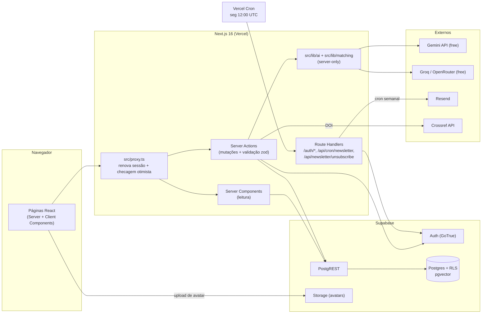
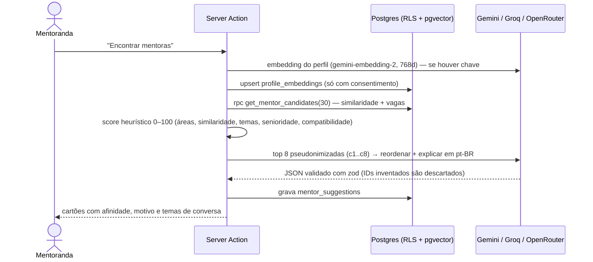

# Arquitetura

Visão técnica de como a Ciência Delas funciona: stack, organização das pastas, fluxo de dados,
autenticação, IA e rotas. Decisões e alternativas descartadas estão nos [ADRs](adr/README.md).

## 1. Stack

| Camada | Tecnologia | Por quê |
| --- | --- | --- |
| Framework | **Next.js 16.4** (App Router, React 19, TypeScript estrito) | Front e back no mesmo repo; Server Components e Server Actions |
| Estilo | **Tailwind CSS v4** (tokens em CSS via `@theme`) | Design system em variáveis CSS, tema claro/escuro |
| Backend | **Supabase**: Auth, Postgres 17 + RLS, Storage, `pgvector` | Backend gerenciado e gratuito, autorização no banco |
| IA | **Gemini** (`gemini-3.5-flash-lite`, `gemini-embedding-2`), **Groq** (`openai/gpt-oss-120b`), **OpenRouter** (`openrouter/free`) | Planos gratuitos, com fallback e modo heurístico |
| E-mail | **Resend** (REST) | 100 e-mails/dia grátis, descadastro one-click |
| Agendamento | **Vercel Cron** (ou `pg_cron` + `pg_net`) | Boletim semanal automático |
| Testes | **Vitest** (unidade), **pgTAP** (`supabase test db`), Playwright (E2E manual/scripts) | |
| Deploy | **Vercel Hobby** + **Supabase Free** | Custo zero |

## 2. Visão de alto nível



**Regra de ouro:** toda leitura e escrita feita em nome de uma usuária usa o cliente Supabase **com a
sessão dela** (`src/lib/supabase/server.ts`), então o **RLS** decide o que ela pode ver e fazer. O cliente
com a chave secreta (`src/lib/supabase/admin.ts`) só aparece em rotinas que não pertencem a uma usuária:
newsletter (inscrição, envio, cron), backfill de embeddings e ações administrativas explícitas.

## 3. Organização das pastas

```
.
├── docs/                      Documentação (este diretório) e ADRs
├── public/brand/              Logo e assets da marca
├── scripts/
│   ├── ai/                    backfill de embeddings (npm run ai:backfill)
│   ├── db/                    geração de tipos, validação sem Docker, stub do Supabase
│   └── e2e/                   helper de cookies de sessão para testes com Playwright
├── supabase/
│   ├── config.toml            configuração local (auth, templates, storage)
│   ├── migrations/            schema versionado (9 migrations)
│   ├── seed.sql               dados fictícios de demonstração
│   ├── templates/             e-mails de autenticação em pt-BR
│   └── tests/database/        testes pgTAP de RLS e regras de negócio
└── src/
    ├── proxy.ts               "middleware" do Next 16
    ├── app/                   rotas (App Router) — uma pasta por área
    ├── components/
    │   ├── ui/                design system (Button, Field, Card, Dialog, ScoreMeter...)
    │   ├── layout/            cabeçalho, rodapé, navegação, tema
    │   └── <área>/            componentes de cada funcionalidade
    └── lib/
        ├── env.ts             leitura centralizada de variáveis de ambiente
        ├── constants.ts       domínios (estágios de carreira, temas de mentoria, UFs...)
        ├── auth.ts            getCurrentUser, requireOnboardedProfile, requireModerator
        ├── database.types.ts  tipos gerados do banco
        ├── supabase/          clientes (browser, server, admin, proxy)
        ├── ai/                provedores de IA, JSON estruturado, tarefas (resumo, editorial)
        ├── matching/          algoritmo de sugestão de mentoras
        ├── ranking/           fórmulas de ranking (espelho do SQL)
        └── <área>/            consultas e server actions de cada funcionalidade
```

Convenção: cada área tem **rotas** em `src/app/<rota>`, **componentes** em `src/components/<área>` e
**lógica/consultas** em `src/lib/<área>`. Server Actions ficam em `actions.ts` dentro da área.

## 4. Fluxo de uma requisição

1. **`src/proxy.ts`** roda antes de tudo (exceto assets, `api/cron` e `api/newsletter`): cria um cliente
   Supabase com os cookies, chama `auth.getClaims()` para **renovar a sessão** e redireciona visitantes de rotas
   protegidas para `/entrar?next=...`.
2. A **página** (Server Component) chama helpers como `requireOnboardedProfile()` (que também manda quem não
   completou o perfil para `/onboarding`) e consulta o banco com o cliente da sessão.
3. **Formulários** chamam **Server Actions** (`"use server"`), que: revalidam a sessão, validam a entrada com
   **zod**, gravam via Supabase (RLS aplicado), tratam erros do banco (códigos `CD001`–`CD015` já vêm com
   mensagem em pt-BR) e chamam `revalidatePath`.
4. **Notificações** (novo pedido de mentoria, resposta no fórum, comentário em paper...) são criadas por
   **triggers** no banco — o app não precisa lembrar de criá-las.

## 5. Autenticação

- E-mail + senha, **link mágico** e Google (opcional). Confirmação de e-mail ligada.
- Os templates de e-mail (`supabase/templates/*.html`, em pt-BR) apontam para `/auth/confirm?token_hash=...`,
  que chama `verifyOtp` (fluxo PKCE recomendado para SSR). OAuth volta por `/auth/callback?code=...`.
- Chaves novas do Supabase: `NEXT_PUBLIC_SUPABASE_PUBLISHABLE_KEY` (`sb_publishable_...`) no front e
  `SUPABASE_SECRET_KEY` (`sb_secret_...`) só no servidor. As chaves legadas (anon/service_role) também funcionam.
- Papéis em `profiles.role`: `member`, `moderator`, `admin`. A coluna não pode ser alterada pela própria usuária
  (GRANT por coluna).

Detalhes: [`11-perfis-e-autenticacao.md`](11-perfis-e-autenticacao.md).

## 6. Mentoria com IA (resumo)



Sem chave de IA ou sem consentimento, os passos de IA são pulados e o score heurístico com explicações por
template é usado. Detalhes, pesos e prompts: [`04-mentoria-com-ia.md`](04-mentoria-com-ia.md).

## 7. Mapa de rotas

| Rota | Acesso | O que é |
| --- | --- | --- |
| `/` | público | Landing: proposta, números da comunidade, destaques da semana |
| `/entrar`, `/cadastro`, `/recuperar-senha`, `/redefinir-senha` | público | Autenticação |
| `/auth/confirm`, `/auth/callback`, `/auth/sair`, `/auth/erro` | — | Rotas técnicas de login/logout |
| `/onboarding` | membra | Perfil em 4 passos |
| `/perfil` | membra | Editar perfil, avatar, consentimentos |
| `/pesquisadoras`, `/pesquisadoras/[id]` | membra | Diretório com filtros e perfil |
| `/forum`, `/forum/c/[slug]`, `/forum/t/[id]`, `/forum/novo` | membra | Fórum |
| `/mentoria` | membra | Sugestões por IA, pedidos enviados/recebidos, mentorias ativas |
| `/papers`, `/papers/[id]` | público | Vitrine e detalhe do paper |
| `/papers/novo`, `/papers/[id]/editar` | membra | Divulgar e editar paper |
| `/ranking` | público (aba Comunidade: membra) | Rankings por período e área |
| `/newsletter`, `/newsletter/[slug]` | público | Inscrição e arquivo do Boletim Delas |
| `/newsletter/confirmar`, `/newsletter/cancelar` | público (token) | Dupla confirmação e descadastro |
| `/notificacoes` | membra | Central de notificações |
| `/admin` | moderadora/admin | Denúncias, newsletter, membros |
| `/sobre`, `/conduta`, `/privacidade`, `/design-system` | público | Institucional e guia de estilo |
| `GET/POST /api/cron/newsletter` | `Bearer CRON_SECRET` | Gera, publica e envia a edição semanal |
| `POST /api/newsletter/unsubscribe` | token | Descadastro one-click (RFC 8058) |

## 8. Segurança em camadas

1. **Banco**: RLS em todas as tabelas, GRANTs por coluna, funções `SECURITY DEFINER` com `search_path = ''`,
   validações em `CHECK`/triggers, testes pgTAP que falham se alguma proteção for removida.
2. **Servidor**: Server Actions revalidam sessão e entrada (zod); a chave secreta nunca vai ao navegador
   (`import "server-only"`).
3. **Proxy**: só checagem otimista e renovação de sessão.
4. **Interface**: Markdown renderizado sem HTML bruto e com links seguros; anonimato tratado nos dados, não só
   na tela.

Checklist completo e LGPD: [`09-moderacao-e-seguranca.md`](09-moderacao-e-seguranca.md).

## 9. Como estender

- **Nova tabela**: crie uma migration em `supabase/migrations/` (`npx supabase migration new nome`) com RLS,
  `revoke all` + `grant` explícitos e índices; adicione testes em `supabase/tests/database/`; rode
  `npm run db:reset && npm run db:test && npm run db:types`.
- **Nova página**: pasta em `src/app/<rota>/page.tsx` com `metadata`, `Container` + `PageHeader` do design
  system; se for só para membras, chame `requireOnboardedProfile()` e inclua o prefixo em
  `PROTECTED_PREFIXES` (`src/lib/constants.ts`).
- **Nova tarefa de IA**: adicione o prompt em `src/lib/ai/tasks/` usando `generateJson` com um schema zod e
  sempre trate `null` (IA indisponível).
