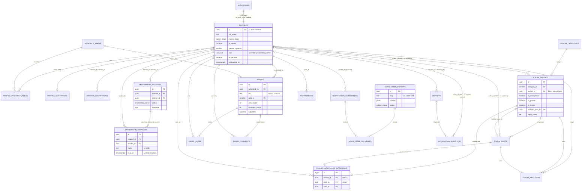
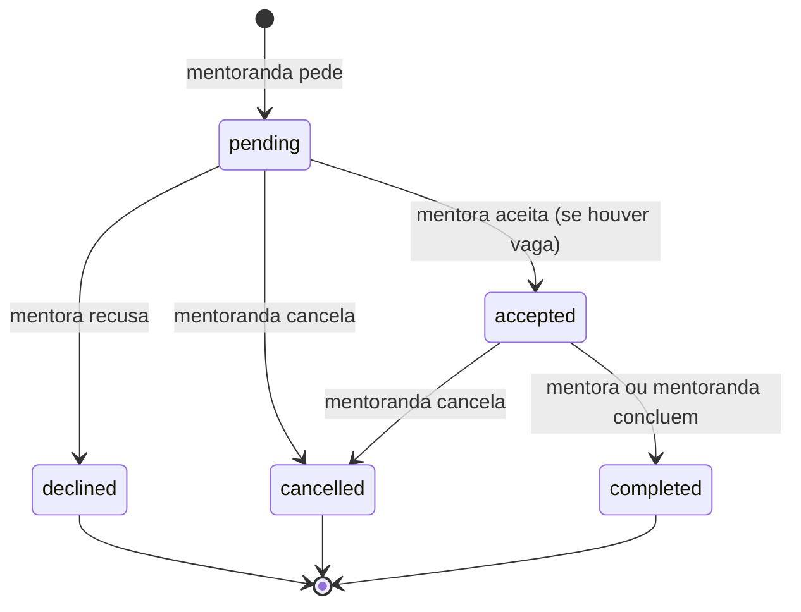
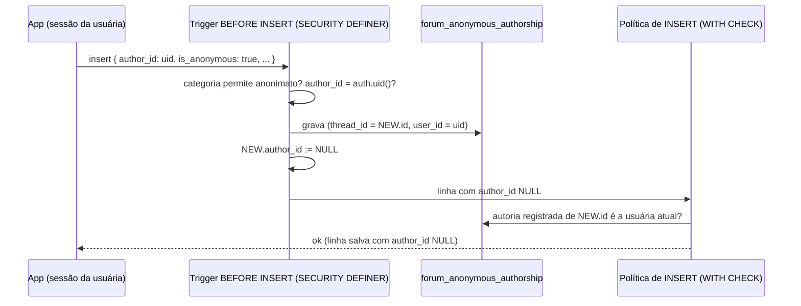

# 03 · Banco de dados (Supabase / Postgres)

Este documento descreve o banco da **Artemis**: modelo de dados, regras de
segurança (RLS), anonimato no fórum, triggers, RPCs, seed de demonstração e como
rodar tudo — com ou sem Docker.

> **Fonte da verdade:** as migrations em `supabase/migrations/`. Se este texto e o SQL
> divergirem, vale o SQL (e, por favor, corrija este documento).

Sumário

1. [Visão geral e convenções](#1-visão-geral-e-convenções)
2. [Diagrama entidade-relacionamento](#2-diagrama-entidade-relacionamento)
3. [Tabelas](#3-tabelas)
4. [Matriz de permissões (RLS + GRANTs)](#4-matriz-de-permissões-rls--grants)
5. [Anonimato no fórum](#5-anonimato-no-fórum)
6. [Triggers](#6-triggers)
7. [RPCs com exemplos em supabase-js](#7-rpcs-com-exemplos-em-supabase-js)
8. [Erros que o app pode mostrar](#8-erros-que-o-app-pode-mostrar)
9. [Consultas com embed (PostgREST)](#9-consultas-com-embed-postgrest)
10. [Storage: avatares](#10-storage-avatares)
11. [Rodando localmente (Docker)](#11-rodando-localmente-docker)
12. [Supabase Cloud](#12-supabase-cloud)
13. [Gerando os tipos TypeScript](#13-gerando-os-tipos-typescript)
14. [Validação local sem Docker](#14-validação-local-sem-docker)
15. [Contas de demonstração](#15-contas-de-demonstração)
16. [Newsletter semanal com pg_cron + pg_net (opcional)](#16-newsletter-semanal-com-pg_cron--pg_net-opcional)
17. [Pegadinhas e boas práticas](#17-pegadinhas-e-boas-práticas)

---

## 1. Visão geral e convenções

| Item         | Escolha                                                                                              |
| ------------ | ---------------------------------------------------------------------------------------------------- |
| Banco        | Postgres 17 do Supabase (local e Cloud). Validado também em Postgres 16 + pgvector 0.6.              |
| Extensões    | `citext`, `vector` (pgvector), `pg_trgm`, `pgcrypto`, `unaccent` — **sempre no schema `extensions`** |
| Schemas      | `public` (exposto pela API), `private` (funções auxiliares de RLS/triggers, **não** exposto)         |
| Autenticação | Supabase Auth (e-mail + senha, magic link, Google opcional). `auth.uid()` identifica a usuária.      |
| Segurança    | RLS em **todas** as tabelas + GRANTs explícitos por tabela e por coluna                              |

Convenções seguidas em todas as migrations:

- **Nada é exposto por padrão.** Desde 2026 o Supabase não concede mais acesso automático
  a tabelas novas para `anon`/`authenticated`. Cada tabela faz `REVOKE ALL` desses papéis
  e depois `GRANT` apenas do necessário — inclusive **GRANT por coluna**
  para `insert`/`update` (é isso que impede uma membro de mudar o próprio `role`, o
  `vote_count` de um paper ou fixar um tópico). O `config.toml` local usa
  `auto_expose_new_tables = false` para reproduzir esse comportamento.
- **Funções** usam `set search_path = ''` e nomes totalmente qualificados
  (`public.profiles`, `extensions.vector`, `a OPERATOR(extensions.<=>) b`).
  `EXECUTE` é revogado de `PUBLIC` e concedido só a quem precisa.
- **Políticas RLS** usam `(select auth.uid())` (avaliado uma vez por consulta, não por
  linha), são escopadas `to authenticated` ou `to anon, authenticated` e toda coluna usada
  em FK ou política tem índice.
- **Erros de regra de negócio** usam SQLSTATE próprios (`CD001`…`CD050`) com mensagens em
  pt-BR prontas para mostrar na interface (ver [seção 8](#8-erros-que-o-app-pode-mostrar)).
- **Identificadores em inglês; textos para pessoas em pt-BR.**

Migrations (em ordem):

| Arquivo                                                | Conteúdo                                                                                                                                                                                                                                                                                                                                                                                                                                                                                                         |
| ------------------------------------------------------ | ---------------------------------------------------------------------------------------------------------------------------------------------------------------------------------------------------------------------------------------------------------------------------------------------------------------------------------------------------------------------------------------------------------------------------------------------------------------------------------------------------------------- |
| `20261027120000_extensions_enums_helpers.sql`          | extensões, endurecimento de privilégios padrão, schema `private`, enums, utilitários                                                                                                                                                                                                                                                                                                                                                                                                                             |
| `20261027120100_profiles.sql`                          | `research_areas`, `profiles`, `profile_research_areas`, `profile_embeddings`, `handle_new_user`, `private.is_moderator()/is_admin()`                                                                                                                                                                                                                                                                                                                                                                             |
| `20261027120200_mentorship.sql`                        | `mentor_suggestions`, `mentorship_requests` (+ máquina de estados e capacidade)                                                                                                                                                                                                                                                                                                                                                                                                                                  |
| `20261027120300_forum.sql`                             | categorias, tópicos, respostas, autoria anônima, reações e views de contagem                                                                                                                                                                                                                                                                                                                                                                                                                                     |
| `20261027120400_papers.sql`                            | `papers`, `paper_votes`, `paper_comments`                                                                                                                                                                                                                                                                                                                                                                                                                                                                        |
| `20261027120500_newsletter.sql`                        | inscritas, edições e envios                                                                                                                                                                                                                                                                                                                                                                                                                                                                                      |
| `20261027120600_moderation_notifications.sql`          | `reports`, `notifications` e triggers que criam notificações                                                                                                                                                                                                                                                                                                                                                                                                                                                     |
| `20261027120700_storage.sql`                           | bucket `avatars` + políticas em `storage.objects`                                                                                                                                                                                                                                                                                                                                                                                                                                                                |
| `20261027120800_rpc.sql`                               | RPCs públicas                                                                                                                                                                                                                                                                                                                                                                                                                                                                                                    |
| `20261028090000_integration.sql`                       | rodada de integração: `moderation_audit_log` + auditoria nas RPCs de moderação, aviso `report_resolved`, revogar IA apaga sugestões, limites de confirmação da newsletter, `get_mentor_open_slots`                                                                                                                                                                                                                                                                                                               |
| `20261028091000_newsletter_mentor_summary.sql`         | converte edições antigas da newsletter: nomes de mentoras → agregado `mentor_summary` (o arquivo é público)                                                                                                                                                                                                                                                                                                                                                                                                      |
| `20261028130000_artemis_brand_texts.sql`               | nova marca (Artemis) nos textos de notificação gerados pelo banco                                                                                                                                                                                                                                                                                                                                                                                                                                                |
| `20261028150000_security_audit.sql`                    | auditoria de segurança: autoria anônima só pela RPC, limites de denúncias e de pedidos de mentoria, cota do matching com IA (`claim_ai_matching_slot`)                                                                                                                                                                                                                                                                                                                                                           |
| `20261028170000_accent_insensitive_search.sql`         | busca sem acento: `unaccent`, `private.unaccent_immutable`/`private.search_text`, colunas geradas `search_text` + índices de trigramas em `profiles`, `forum_threads` e `papers`                                                                                                                                                                                                                                                                                                                                 |
| `20261028170100_anti_spam_limits.sql`                  | limites anti-spam por pessoa (`CD021`–`CD025`, `CD019` e `CD020` revistos), registro privado `private.rate_limit_events`                                                                                                                                                                                                                                                                                                                                                                                         |
| `20261028170200_moderation_audit_avatar_hardening.sql` | `delete_content` gravado por trigger (BEFORE DELETE) + RPC `moderate_delete_content`; `profiles.avatar_url` só NULL ou o avatar da própria pasta no Storage                                                                                                                                                                                                                                                                                                                                                      |
| `20261028170300_search_text_trigger_fix.sql`           | `forum_threads_before_update`/`papers_before_write` ignoram `search_text` ao decidir se `updated_at` muda (coluna gerada chega NULL no trigger BEFORE)                                                                                                                                                                                                                                                                                                                                                           |
| `20261028170400_panel_delete_audit_anonymity.sql`      | exclusão pelo painel (`moderate_delete_content`) sempre gera `delete_content`, mesmo da própria autora: a linha que faltava revelava autoria anônima                                                                                                                                                                                                                                                                                                                                                             |
| `20261028170500_panel_delete_audit_null_fix.sql`       | corrige a anterior: fora do painel, a autora apagando o próprio conteúdo volta a não gerar linha (comparação com NULL)                                                                                                                                                                                                                                                                                                                                                                                           |
| `20261028181500_mentorship_messages.sql`               | conversa da mentoria: `mentorship_messages` (RLS só das participantes, envio só com o pedido aceito, só `read_at` muda), aviso `mentorship_message` agrupado por conversa, limite de 60 mensagens/h (`CD026`), conversa encerrada (`CD027`), limpeza dos avisos quando o pedido some                                                                                                                                                                                                                             |
| `20261028190000_mentorship_recognition.sql`            | reconhecimento da mentoria ([docs/15](15-reconhecimento-da-mentoria.md)): `mentorship_requests.completed_at` + trigger próprio; `mentorship_feedback` (retorno privado, só a autora lê); `mentorship_declarations` (declaração de participação); RPCs `consent_`/`revoke_`/`verify_mentorship_declaration` e `get_mentorship_impact` (agregados em blocos de 5); `private.notify_mentorship_change` recriada com o mesmo corpo, só o link da conclusão muda para `/mentoria/concluida/<pedido>`; `CD030`–`CD037` |
| `20261028190100_public_questions.sql`                  | Pergunte a uma cientista ([docs/16](16-pergunte-a-uma-cientista.md)): `public_questions` (sem autora; só o hash do link de acompanhamento) e `public_answers`; detector de dados pessoais `private.detect_personal_data`; 9 RPCs (envio, andamento e exclusão pelo link, listas públicas, fila e decisões da moderação); listas completas de `rate_limit_events_action_check` (+ `public_answer`) e dos CHECKs de `moderation_audit_log` (+ 4 ações e 2 alvos); `CD040`–`CD047`                                  |
| `20261028190200_trajectory_affinity.sql`               | afinidade de trajetória ([docs/17](17-afinidade-de-trajetoria.md)): `profiles.trajectory_tags` (catálogo fechado de 8 marcas, CHECK + trigger de normalização, GRANT por coluna, índice GIN); `get_mentor_candidates` recriada com `trajectory_tags` como última coluna; `CD050`                                                                                                                                                                                                                                 |

---

## 2. Diagrama entidade-relacionamento



---

## 3. Tabelas

Enums: `career_stage`, `user_role`, `meeting_format`, `mentorship_status`, `reaction_kind`,
`report_target`, `report_reason`, `report_status`, `subscriber_status`, `edition_status`,
`notification_type` (valores no CONTRACT §4 e em `Constants.public.Enums` dos tipos gerados).

### Perfis e áreas

| Tabela                   | Para que serve                                                                                                                                                         | Regras importantes                                                                                                                                                                                                                                                                                                                                                                                                                                                                                                          |
| ------------------------ | ---------------------------------------------------------------------------------------------------------------------------------------------------------------------- | --------------------------------------------------------------------------------------------------------------------------------------------------------------------------------------------------------------------------------------------------------------------------------------------------------------------------------------------------------------------------------------------------------------------------------------------------------------------------------------------------------------------------- |
| `research_areas`         | Catálogo de áreas: as 9 grandes áreas do CNPq + subáreas. Linhas com `name = big_area` são a própria grande área.                                                      | Leitura pública. Escrita só via migration/seed.                                                                                                                                                                                                                                                                                                                                                                                                                                                                             |
| `profiles`               | Perfil de cada usuária (1:1 com `auth.users`), criado automaticamente no cadastro. Guarda dados públicos para membros, preferências de mentoria e consentimento de IA. | Leitura **só para membros**. A dona edita todas as colunas **exceto** `id`, `role`, `created_at`, `updated_at`. Trigger normaliza (trim, strings vazias → `NULL`, UF maiúscula, palavras-chave em minúsculas, `ai_consent_at`). URLs precisam começar com `http(s)://` (evita `javascript:`); `avatar_url` só aceita NULL ou o avatar público da **própria** pasta no Storage ([seção 10](#10-storage-avatares)). `mentorship_topics` só aceita slugs do catálogo (§7 do contrato). `search_text` é gerada (busca, abaixo). |
| `profile_research_areas` | Áreas (N:N) de cada perfil.                                                                                                                                            | Membros leem; a dona insere/remove as próprias.                                                                                                                                                                                                                                                                                                                                                                                                                                                                             |
| `profile_embeddings`     | Vetor `vector(768)` do perfil (Gemini), hash do texto e modelo. Usado no matching.                                                                                     | **Só a dona** lê/escreve. Outras pessoas nunca veem vetores: o matching usa a RPC `get_mentor_candidates` (SECURITY DEFINER). Revogar `ai_consent` apaga o embedding (e as sugestões de mentoras). Índice HNSW (`vector_cosine_ops`).                                                                                                                                                                                                                                                                                       |

### Mentoria

| Tabela                | Para que serve                                                                                                                  | Regras importantes                                                                                                                                                                                                                                                                                                                                                                                                                                                                                                                                                                   |
| --------------------- | ------------------------------------------------------------------------------------------------------------------------------- | ------------------------------------------------------------------------------------------------------------------------------------------------------------------------------------------------------------------------------------------------------------------------------------------------------------------------------------------------------------------------------------------------------------------------------------------------------------------------------------------------------------------------------------------------------------------------------------ |
| `mentor_suggestions`  | Sugestões de mentoras calculadas para a mentoranda (IA ou heurística), com nota 0–100, motivo e sugestões de primeira conversa. | Só a mentoranda (`mentee_id`) vê/grava/apaga (aceita upsert). Mentoras não veem. Revogar `ai_consent` apaga todas as sugestões da mentoranda (trigger); as heurísticas podem ser recalculadas sem IA.                                                                                                                                                                                                                                                                                                                                                                                |
| `mentorship_requests` | Pedido de mentoria e seu ciclo de vida.                                                                                         | A mentoranda cria (mensagem 20–1500 caracteres) para quem `is_mentor` e `mentor_available`. Participantes leem. Só `status` e `response_message` podem ser alterados, e o trigger aplica a máquina de estados e a capacidade (ver [seção 6](#6-triggers)). Índice único impede dois pedidos abertos (`pending`/`accepted`) para o mesmo par.                                                                                                                                                                                                                                         |
| `mentorship_messages` | Conversa da mentoria (`/mentoria/conversa/<pedido>`): mensagens entre mentora e mentoranda, com recibo de leitura (`read_at`).  | **Só as duas participantes** leem (nem a moderação). Envio em nome próprio (`sender_id` = `auth.uid()`, padrão) e só com o pedido `accepted`: concluída/cancelada fica só leitura (`CD027`); pedido alheio ou inexistente → `CD015` (mesmo erro, nada vaza). Texto de 1 a 2.000 caracteres sem os espaços das pontas; `created_at` e `read_at` vêm do servidor. Só `read_at` muda, só pela destinatária, uma vez (não volta a NULL). Ninguém apaga pela API; some em cascata com o pedido ou a conta. 60 mensagens por hora por pessoa (`CD026`). Índice `(request_id, created_at)`. |

Máquina de estados:



### Funcionalidades de 28/10: reconhecimento, Pergunte e trajetória

Detalhes completos (RLS, GRANTs, RPCs e testes) nos documentos de cada funcionalidade.

| Tabela / coluna                    | Para que serve                                                                                       | Regras importantes                                                                                                                                                                                                                                                                      |
| ---------------------------------- | ---------------------------------------------------------------------------------------------------- | --------------------------------------------------------------------------------------------------------------------------------------------------------------------------------------------------------------------------------------------------------------------------------------- |
| `mentorship_requests.completed_at` | Quando a mentoria foi concluída (trigger próprio; nunca pela API).                                   | Fora do GRANT de escrita (`42501`). Base do período da declaração e do prazo do retorno. [docs/15 §3.1](15-reconhecimento-da-mentoria.md)                                                                                                                                               |
| `mentorship_feedback`              | Retorno privado de cada participante ao concluir (nota 1–5, o que mudou, recomendaria, comentário).  | **Só a autora** lê (nem a outra participante, nem moderação, nem admin); um por pessoa e mentoria (`CD032`); só de mentoria concluída (`CD030`); a autora apaga. Agregados públicos só por `get_mentorship_impact` (k = 5, em blocos de 5). [docs/15](15-reconhecimento-da-mentoria.md) |
| `mentorship_declarations`          | Declaração de participação com código `ART-XXXX-XXXX-XXXX`, emitida quando as duas autorizam.        | Só as participantes leem; criada pelo GRANT de `request_id`; autorizar/revogar só pelas RPCs; não pode ser reescrita (`CD037`); até 5 pedidos por mentoria (`CD036`). Verificação pública por `verify_mentorship_declaration` (sem nomes se revogada).                                  |
| `public_questions`                 | Pergunta de estudante, **sem autora**: nenhum identificador, só o SHA-256 do link de acompanhamento. | Público lê só publicadas e sem `created_at`; nenhuma escrita pela API (só RPCs); fila de 50 pendentes (`CD040`); dados pessoais recusados no banco (`CD041`); recusadas apagadas 30 dias depois. [docs/16](16-pergunte-a-uma-cientista.md)                                              |
| `public_answers`                   | Resposta pública de uma membra com cadastro completo.                                                | Identidade só com `show_identity`; sem contatos (`CD047`); 20 por hora (`CD045`); moderação oculta/reexibe; `hidden_by` fora do GRANT de leitura.                                                                                                                                       |
| `profiles.trajectory_tags`         | Marcas opcionais de trajetória (8 slugs do catálogo).                                                | Só membras leem; só a dona altera (GRANT por coluna); fora do catálogo → `CD050`; nenhuma função de `anon` lê a coluna; nunca vai para a IA. [docs/17](17-afinidade-de-trajetoria.md)                                                                                                   |

### Fórum

| Tabela                                                        | Para que serve                                                                                       | Regras importantes                                                                                                                                                                               |
| ------------------------------------------------------------- | ---------------------------------------------------------------------------------------------------- | ------------------------------------------------------------------------------------------------------------------------------------------------------------------------------------------------ |
| `forum_categories`                                            | As 8 categorias (ícone = nome do ícone do lucide em kebab-case). `allow_anonymous` liga o anonimato. | Leitura pública (para a landing).                                                                                                                                                                |
| `forum_threads`                                               | Tópicos (markdown). `author_id` é `NULL` quando anônimo.                                             | **Só membros** leem. Membros editam apenas `title`, `body`, `tags`, `solution_post_id`. Fixar/trancar só via RPC `moderate_thread`. `reply_count` e `last_activity_at` são mantidos por trigger. |
| `forum_posts`                                                 | Respostas. Mesmo esquema de anonimato.                                                               | Inserção bloqueada em tópico trancado (exceto moderação). Membros editam só `body`.                                                                                                              |
| `forum_anonymous_authorship`                                  | Quem escreveu cada tópico/resposta anônima.                                                          | Pela API, cada pessoa lê **só a própria autoria** (nem a moderação lê as outras: revelar só pela RPC `reveal_anonymous_author`, com motivo e auditoria). Nenhuma escrita pela API (só triggers). |
| `forum_reactions`                                             | Reações `support`/`useful`/`celebrate` em tópico **ou** resposta.                                    | Uma por pessoa, alvo e tipo (constraint `forum_reactions_unique`, serve para upsert).                                                                                                            |
| `forum_thread_reaction_counts` / `forum_post_reaction_counts` | Views (`security_invoker`) com `(alvo, kind, total)`.                                                | Mesmas permissões das reações (membros).                                                                                                                                                         |

### Vitrine de papers

| Tabela           | Para que serve                                                                                                                             | Regras importantes                                                                                                                                                                                                                                                            |
| ---------------- | ------------------------------------------------------------------------------------------------------------------------------------------ | ----------------------------------------------------------------------------------------------------------------------------------------------------------------------------------------------------------------------------------------------------------------------------- |
| `papers`         | Papers com autoria de mulheres: título, resumo, autoras, DOI/URL, área, resumo em linguagem simples (`plain_summary`, da IA ou da autora). | Leitura **pública** (exceto ocultos: só quem enviou e a moderação veem). Exige `women_authorship_confirmed = true`. DOI é normalizado (sem `https://doi.org/`, minúsculo) e único. `vote_count`, `comment_count`, `is_hidden` e `submitted_by` não são editáveis por membros. |
| `paper_votes`    | Voto positivo (um por pessoa).                                                                                                             | Leitura pública. Ninguém vota no próprio paper (erro `CD012`) nem em paper oculto. `created_at` não é enviado pelo cliente (impede "antedatar" votos).                                                                                                                        |
| `paper_comments` | Comentários de membros.                                                                                                                    | Leitura só para membros; a autora edita/apaga; moderação apaga.                                                                                                                                                                                                               |

### Busca sem acento (`search_text`)

`profiles`, `forum_threads` e `papers` têm a coluna gerada **`search_text`** (`STORED`, só leitura),
com índice GIN de trigramas (`extensions.gin_trgm_ops`). Ela junta os campos pesquisáveis já
normalizados — `lower(unaccent(...))`, espaços colapsados —, então "Jacarei" encontra "Jacareí" e
"REVISAO" encontra "revisão":

| Tabela          | Campos em `search_text`                                        | Quem lê (igual à tabela)                |
| --------------- | -------------------------------------------------------------- | --------------------------------------- |
| `profiles`      | `full_name`, `institution`, `headline`, `city`, `keywords`     | membros                                 |
| `forum_threads` | `title`, `body`, `tags` — **nunca** a autoria (anônima ou não) | membros                                 |
| `papers`        | `title`, `abstract`, `authors`, `keywords`, `venue`            | visitantes e membros (RLS: só visíveis) |

- `private.unaccent_immutable(text)` é um wrapper `IMMUTABLE` de `extensions.unaccent` com o
  dicionário fixado (`'extensions.unaccent'::regdictionary`, resolvido quando a função é criada):
  funciona com `search_path = ''` e pode entrar em coluna gerada/índice. `private.search_text(text[])`
  monta o texto (partes NULL são ignoradas). `concat_ws`/`array_to_string` são `STABLE` e não podem
  aparecer direto numa coluna gerada — por isso a função. Se as regras do `unaccent` mudarem, um
  `UPDATE` qualquer nas linhas recalcula a coluna.
- O app normaliza o termo do mesmo jeito em `src/lib/search/normalize.ts` (NFC; NFD e sem
  diacríticos só nas letras latinas e gregas, como o `unaccent` — "й", Hangul e kana ficam como
  estão; ligaduras como "fi" viram letras; minúsculas, espaços colapsados, `%`/`_`/`\` escapados,
  `*` removido) e aplica **um `.ilike` por palavra** (todas obrigatórias, em qualquer campo e
  ordem):

```ts
import { applySearchText } from "@/lib/search/normalize";

let query = supabase.from("papers").select("id, title").eq("is_hidden", false);
query = applySearchText(query, "revisao sistematica"); // search_text ilike %revisao% e %sistematica%
```

Usado no diretório (`/pesquisadoras?q=`), na busca do fórum (`/forum?q=`) e na Vitrine (`/papers?q=`).

### Newsletter

| Tabela                   | Para que serve                                                                                                                                                                                                                    | Regras importantes                                                                                                                                                                      |
| ------------------------ | --------------------------------------------------------------------------------------------------------------------------------------------------------------------------------------------------------------------------------- | --------------------------------------------------------------------------------------------------------------------------------------------------------------------------------------- |
| `newsletter_subscribers` | Inscritas (double opt-in), áreas de interesse (`area_ids` vazio = todas), tokens de confirmação/descadastro, texto do consentimento (LGPD), `confirmation_sent_count`/`confirmation_sent_at` (limites de e-mails de confirmação). | **Sem acesso pela API**: só service role (`createAdminClient()`). Envio de confirmação reservado pela RPC `newsletter_reserve_confirmation` (3 por endereço a cada 24 h + teto diário). |
| `newsletter_editions`    | Edições semanais (`content` jsonb: `papers`, `threads`, `mentors: []`, `mentor_summary: { total, areas }`, `stats` — docs/08 §3).                                                                                                 | Edições `published`/`sent` são públicas (inclusive o jsonb, pela API) — por isso **nada de nomes de mentoras**; rascunhos só para admins. Publicar preenche `published_at`.             |
| `newsletter_deliveries`  | Registro de envio por inscrita (id do provedor, erro).                                                                                                                                                                            | Só service role.                                                                                                                                                                        |

### Moderação e notificações

| Tabela                 | Para que serve                                                                                                                                                                                                                                                                                                           | Regras importantes                                                                                                                                                                                                                                           |
| ---------------------- | ------------------------------------------------------------------------------------------------------------------------------------------------------------------------------------------------------------------------------------------------------------------------------------------------------------------------ | ------------------------------------------------------------------------------------------------------------------------------------------------------------------------------------------------------------------------------------------------------------ |
| `reports`              | Denúncias de tópico, resposta, paper, comentário ou perfil.                                                                                                                                                                                                                                                              | A denunciante cria e vê as próprias; moderação vê todas e resolve (`resolved_by`/`resolved_at` são preenchidos pelo trigger com quem resolveu). `resolution_note` é **visível para quem denunciou** (vai no aviso `report_resolved`); nada interno vai nela. |
| `moderation_audit_log` | Registro das ações da moderação: `actor_id`, `action` (`reveal_author`, `hide_paper`, `unhide_paper`, `lock_thread`, `unlock_thread`, `pin_thread`, `unpin_thread`, `delete_content`, `resolve_report`, `dismiss_report`, `change_role`), alvo (`target_type`/`target_id`), `report_id`, `reason` (≤ 500), `created_at`. | **Só moderação lê**; inclui só em nome próprio (`actor_id = auth.uid()`); **ninguém edita nem apaga** pela API. As RPCs de moderação, o trigger de denúncias e o de exclusões (`delete_content`) gravam sozinhos (docs/09 §8).                               |
| `notifications`        | Avisos para a usuária (pedido de mentoria, resposta, mensagem nova na conversa da mentoria — um aviso não lido por conversa —, nova resposta no tópico, solução marcada, comentário no paper, denúncia concluída).                                                                                                       | Cada uma vê/apaga as próprias e só pode alterar `read_at`. Criadas **apenas** por triggers. Publicadas no Realtime (`supabase_realtime`), que respeita o RLS.                                                                                                |

---

## 4. Matriz de permissões (RLS + GRANTs)

Legenda: **L** ler · **C** criar · **E** editar · **A** apagar · — sem acesso.
"Dona" = a própria usuária (autora, quem enviou, participante). `service_role` ignora RLS
e tem acesso total a tudo (use só no servidor).

| Recurso                                           | Visitante (`anon`)       | Membro               | Dona / participante                                                              | Moderação                                                      | Admin               |
| ------------------------------------------------- | ------------------------ | -------------------- | -------------------------------------------------------------------------------- | -------------------------------------------------------------- | ------------------- |
| `research_areas`, `forum_categories`              | L                        | L                    | —                                                                                | L                                                              | L                   |
| `profiles`                                        | —                        | L (todos)            | E (exceto `id`, `role`, `created_at`, `updated_at`)                              | igual a membro                                                 | igual a membro      |
| `profile_research_areas`                          | —                        | L                    | C / A                                                                            | —                                                              | —                   |
| `profile_embeddings`                              | —                        | —                    | L / C / E / A                                                                    | —                                                              | —                   |
| `mentor_suggestions`                              | —                        | —                    | mentoranda: L / C / E / A                                                        | —                                                              | —                   |
| `mentorship_requests`                             | —                        | —                    | L; mentoranda C; ambas E (`status`, `response_message`*)                         | —                                                              | —                   |
| `mentorship_messages`                             | —                        | —                    | L; C (só com o pedido aceito, em nome próprio); E (`read_at`, só a destinatária) | —                                                              | —                   |
| `forum_threads`                                   | —                        | L                    | C; E (`title`, `body`, `tags`, `solution_post_id`); A                            | E / A + `moderate_thread`                                      | igual à moderação   |
| `forum_posts`                                     | —                        | L                    | C (tópico aberto); E (`body`); A                                                 | E / A; responde em tópico trancado                             | igual à moderação   |
| `forum_anonymous_authorship`                      | —                        | —                    | L (a própria)                                                                    | L (a própria) + `reveal_anonymous_author` (motivo + auditoria) | igual à moderação   |
| `forum_reactions` + views                         | —                        | L                    | C / A                                                                            | —                                                              | —                   |
| `papers`                                          | L (não ocultos)          | L (não ocultos)      | C; E (campos editoriais); A; L ocultos                                           | L ocultos; A; `moderate_paper`                                 | igual à moderação   |
| `paper_votes`                                     | L                        | L                    | C (não no próprio paper) / A                                                     | —                                                              | —                   |
| `paper_comments`                                  | —                        | L                    | C; E (`body`); A                                                                 | A                                                              | A                   |
| `newsletter_subscribers`, `newsletter_deliveries` | —                        | —                    | —                                                                                | —                                                              | — (só service role) |
| `newsletter_editions`                             | L (publicadas)           | L (publicadas)       | —                                                                                | L (publicadas)                                                 | L / C / E / A       |
| `reports`                                         | —                        | C (como denunciante) | L (as próprias)                                                                  | L / E (`status`, `resolution_note`, ...)                       | igual à moderação   |
| `moderation_audit_log`                            | —                        | —                    | —                                                                                | L / C (em nome próprio)                                        | igual à moderação   |
| `notifications`                                   | —                        | —                    | L / E (`read_at`) / A                                                            | —                                                              | —                   |
| `storage` bucket `avatars`                        | leitura pela URL pública | —                    | L / C / E / A em `<uid>/...`                                                     | —                                                              | —                   |

\* `response_message` só pela mentora; transições conforme a máquina de estados.

RPCs (`EXECUTE`):

| RPC                                                                           | `anon`                | `authenticated` | Observação                                                       |
| ----------------------------------------------------------------------------- | --------------------- | --------------- | ---------------------------------------------------------------- |
| `is_moderator()`, `is_admin()`                                                | sim (retorna `false`) | sim             |                                                                  |
| `get_paper_ranking(...)`                                                      | sim                   | sim             | SECURITY INVOKER                                                 |
| `get_platform_stats()`                                                        | sim                   | sim             | só contagens agregadas                                           |
| `get_mentor_candidates(...)`                                                  | —                     | sim             |                                                                  |
| `get_mentor_open_slots(p_ids)`                                                | —                     | sim             | SECURITY DEFINER, até 200 ids                                    |
| `get_mentorship_contact(...)`                                                 | —                     | sim             | só participante de mentoria **aceita**                           |
| `get_community_leaderboard(...)`                                              | —                     | sim             |                                                                  |
| `reveal_anonymous_author(...)`, `moderate_thread(...)`, `moderate_paper(...)` | —                     | sim             | erro `42501` se não for moderação; gravam `moderation_audit_log` |
| `moderate_delete_content(...)`                                                | —                     | sim             | SECURITY INVOKER; `42501` se não for moderação; o trigger audita |
| `newsletter_reserve_confirmation(...)`                                        | —                     | —               | só `service_role`                                                |

---

## 5. Anonimato no fórum

Categorias com `allow_anonymous = true` (seed: **Maternidade e cuidado**, **Rede de apoio —
assédio e desafios** e **Saúde mental**) aceitam tópicos e respostas anônimas. O objetivo é
que **nenhuma outra membro** consiga descobrir a autoria, mas que a autora continue dona do
conteúdo (editar, apagar, receber notificações) e que a moderação consiga agir em casos
graves.

Fluxo de um tópico anônimo:



Garantias (todas cobertas por testes em `supabase/tests/database/rls.test.sql`):

- **Sem falsificação:** o trigger exige `author_id = auth.uid()` em qualquer inserção (anônima
  ou não) — erro `CD013`. Ninguém publica em nome de outra pessoa.
- **Sem conteúdo anônimo "órfão":** o RLS (avaliado _depois_ dos triggers BEFORE) só aceita
  linha anônima com `author_id IS NULL` se a autoria registrada para aquele id for a usuária
  atual. Mesmo se alguém desativasse o trigger, o insert seria barrado (há teste para isso).
  A FK da tabela de autoria é `DEFERRABLE INITIALLY DEFERRED` porque a linha de autoria é
  gravada antes de o tópico existir de fato; a função que a política consulta é `VOLATILE`
  para enxergar essa linha dentro do mesmo comando.
- **Sem desfazer o anonimato:** `is_anonymous` e `author_id` não têm GRANT de UPDATE e um
  trigger BEFORE UPDATE também recusa a mudança.
- **Categoria certa:** anonimato fora de categoria permitida → `CD010`. Respostas anônimas
  seguem a categoria do tópico.
- **Visibilidade:** outras membros veem `author_id = NULL` e não conseguem ler
  `forum_anonymous_authorship` (cada pessoa lê só a própria autoria). O app mostra "Anônima".
- **A autora continua dona:** políticas de UPDATE/DELETE aceitam quem tem a autoria
  registrada; notificações de resposta chegam para ela normalmente.
- **Moderação:** moderadoras **não** leem a tabela de autoria pela API (até a auditoria de
  segurança de 28/10 liam — um `select` revelava todas as autoras sem motivo nem registro). A
  única forma é `reveal_anonymous_author()`, em casos graves (assédio, ameaça): o motivo (20–300
  caracteres) é **obrigatório** e a revelação fica em `moderation_audit_log` na mesma transação
  (sem o nome revelado). O painel só oferece a ação a admins.
- **Ranking da comunidade:** conteúdo anônimo **não** conta pontos (senão vazaria autoria).
- **LGPD — exclusão de conta:** apagar a usuária remove em cascata as linhas de autoria, e um
  trigger AFTER DELETE apaga junto o tópico/resposta anônimo correspondente.

---

## 6. Triggers

| Tabela                                                                    | Trigger                                     | O que faz                                                                                                                                                                                                                                                                                                                                                                                                                                                         |
| ------------------------------------------------------------------------- | ------------------------------------------- | ----------------------------------------------------------------------------------------------------------------------------------------------------------------------------------------------------------------------------------------------------------------------------------------------------------------------------------------------------------------------------------------------------------------------------------------------------------------- |
| `auth.users`                                                              | `on_auth_user_created`                      | Cria o perfil com `full_name` (`full_name` ou `name` do `raw_user_meta_data`). `avatar_url`/`picture` só ficam se forem o avatar da própria pasta no Storage — na prática a foto do provedor (Google) é descartada e o perfil começa com as iniciais.                                                                                                                                                                                                             |
| `profiles`                                                                | `profiles_before_write`                     | Normaliza campos; atualiza `updated_at`; preenche/limpa `ai_consent_at`.                                                                                                                                                                                                                                                                                                                                                                                          |
| `profiles`                                                                | `profiles_after_consent_revoked`            | Revogou `ai_consent` → apaga o embedding e as sugestões de mentoras (`mentor_suggestions`) da mentoranda.                                                                                                                                                                                                                                                                                                                                                         |
| `profile_embeddings`, `newsletter_subscribers`                            | `*_set_updated_at`                          | Atualiza `updated_at`.                                                                                                                                                                                                                                                                                                                                                                                                                                            |
| `mentorship_requests`                                                     | `mentorship_requests_before_insert`         | Mensagens amigáveis: não é mentora / indisponível (`CD003`), pedido duplicado (`CD004`); limites contra pedir-e-cancelar em laço: 3 pedidos para a mesma mentora a cada 7 dias e 5 a cada 24 h (`CD020`; moderação sem o limite diário).                                                                                                                                                                                                                          |
| `mentorship_requests`                                                     | `mentorship_requests_before_update`         | Máquina de estados (`CD002`), só participantes (`CD003`), só a mentora escreve a resposta, capacidade da mentora ao aceitar (`CD001`, com lock para aceites simultâneos), `responded_at`.                                                                                                                                                                                                                                                                         |
| `mentorship_requests`                                                     | `mentorship_requests_notify_insert/update`  | Notifica a mentora (novo pedido) e a outra participante (aceite, recusa, cancelamento, conclusão).                                                                                                                                                                                                                                                                                                                                                                |
| `mentorship_requests`                                                     | `mentorship_requests_after_delete_messages` | Pedido apagado (em geral pela exclusão de uma conta) → apaga os avisos `mentorship_message` daquela conversa que ficaram com a outra participante.                                                                                                                                                                                                                                                                                                                |
| `mentorship_messages`                                                     | `mentorship_messages_before_insert`         | Participante do pedido (`CD015`, sem revelar se o pedido existe), autoria (`CD013`), pedido `accepted` (`CD027`: "Esta mentoria foi concluída/cancelada: a conversa fica guardada só para leitura."), texto sem espaços nas pontas, `created_at`/`read_at` do servidor e limite de 60/h (`CD026`, `private.enforce_rate_limit`, ação `mentorship_message`). `FOR SHARE` no pedido: uma conclusão simultânea não deixa mensagem passar.                            |
| `mentorship_messages`                                                     | `mentorship_messages_before_update`         | Só `read_at` muda (`CD002`, vale também para a service role); só quem recebeu marca; a leitura usa a hora do servidor e não é desfeita.                                                                                                                                                                                                                                                                                                                           |
| `mentorship_messages`                                                     | `mentorship_messages_notify`                | Avisa a outra participante (`mentorship_message`, link `/mentoria/conversa/<pedido>`), a menos que ela já tenha um aviso **não lido** desta conversa (agrupamento; lock por destinatária + conversa).                                                                                                                                                                                                                                                             |
| `forum_threads`                                                           | `forum_threads_before_insert`               | Autoria (`CD013`), anonimato (`CD010`) e registro da autoria anônima.                                                                                                                                                                                                                                                                                                                                                                                             |
| `forum_threads`                                                           | `forum_threads_before_update`               | Bloqueia troca de autoria/anonimato; valida `solution_post_id` (`CD014`); `edited_at`/`updated_at`.                                                                                                                                                                                                                                                                                                                                                               |
| `forum_threads`                                                           | `forum_threads_notify_solution`             | Solução marcada → notifica a autora da resposta.                                                                                                                                                                                                                                                                                                                                                                                                                  |
| `forum_posts`                                                             | `forum_posts_before_insert`                 | Autoria, tópico trancado (`CD011`), anonimato.                                                                                                                                                                                                                                                                                                                                                                                                                    |
| `forum_posts`                                                             | `forum_posts_before_update`                 | Bloqueia troca de autoria/anonimato/tópico; `edited_at`.                                                                                                                                                                                                                                                                                                                                                                                                          |
| `forum_posts`                                                             | `forum_posts_after_insert/delete`           | Mantém `reply_count` e `last_activity_at`.                                                                                                                                                                                                                                                                                                                                                                                                                        |
| `forum_posts`                                                             | `forum_posts_notify_reply`                  | Nova resposta → notifica a autora do tópico (inclusive anônima).                                                                                                                                                                                                                                                                                                                                                                                                  |
| `forum_anonymous_authorship`                                              | `..._after_delete`                          | Apaga o conteúdo anônimo quando a autoria some (LGPD).                                                                                                                                                                                                                                                                                                                                                                                                            |
| `papers`                                                                  | `papers_before_write`                       | Normaliza DOI/strings/palavras-chave; `updated_at` só muda em edição real (votos não contam).                                                                                                                                                                                                                                                                                                                                                                     |
| `paper_votes`                                                             | `paper_votes_before_insert`                 | Sem voto no próprio paper (`CD012`) nem em paper oculto (`CD015`).                                                                                                                                                                                                                                                                                                                                                                                                |
| `paper_votes`                                                             | `paper_votes_after_insert/delete`           | Mantém `vote_count`.                                                                                                                                                                                                                                                                                                                                                                                                                                              |
| `paper_comments`                                                          | `..._after_insert/delete`, `..._notify`     | Mantém `comment_count`; notifica quem enviou o paper.                                                                                                                                                                                                                                                                                                                                                                                                             |
| `newsletter_editions`                                                     | `newsletter_editions_before_write`          | Preenche `published_at`/`sent_at` ao mudar o status.                                                                                                                                                                                                                                                                                                                                                                                                              |
| `reports`                                                                 | `reports_before_write`                      | Força `status = 'open'` na criação; recusa alvo inexistente/invisível (`CD015`), denúncia repetida ainda aberta (`CD018`) e mais de 10 em 24 h (`CD019`; moderação sem limite); ao resolver preenche `resolved_by`/`resolved_at`.                                                                                                                                                                                                                                 |
| `reports`                                                                 | `reports_after_status_change`               | Aberta → resolvida/arquivada: grava `resolve_report`/`dismiss_report` no registro de auditoria e avisa a denunciante (`report_resolved`, com a nota, sem dizer quem moderou).                                                                                                                                                                                                                                                                                     |
| `forum_threads`, `forum_posts`, `paper_comments`, `papers`, `paper_votes` | `*_rate_limit` (BEFORE INSERT)              | Limite anti-spam por pessoa (`private.enforce_rate_limit`): 5 tópicos/h (`CD021`), 30 respostas/h (`CD022`), 20 comentários/h (`CD023`), 5 papers/24 h (`CD024`), 60 destaques/h (`CD025`). Moderação e contexto confiável sem limite. Conta em `private.rate_limit_events` (apagar o conteúdo não devolve a cota).                                                                                                                                               |
| `forum_threads`, `forum_posts`, `papers`, `paper_comments`                | `*_audit_moderator_delete` (BEFORE DELETE)  | Moderadora/admin apagando conteúdo de **outra** pessoa (em qualquer tela ou pela API) → `delete_content` em `moderation_audit_log`. Não registra a própria autora (inclusive anônima) fora do painel — pela RPC `moderate_delete_content` registra sempre, para a linha que faltaria não revelar autoria anônima —, contexto confiável nem o que some em cascata. BEFORE porque a cascata da FK apaga a linha de autoria anônima antes de qualquer trigger AFTER. |

Funções auxiliares no schema `private` (não expostas pela API): `is_moderator()`,
`is_admin()`, `is_anonymous_thread_author()`, `is_anonymous_post_author()` (respondem só
"a usuária atual é a autora anônima?", sem revelar ninguém),
`thread_real_author()`, `post_real_author()`, `notify()`, `log_moderation()`, `display_name()`,
`normalize_tags()`, `text_array_ok()`, `is_trusted_context()`, `set_updated_at()`,
`unaccent_immutable()`, `search_text()` (busca), `enforce_rate_limit()` (limites anti-spam, também
usada pela conversa da mentoria),
`is_own_avatar_url()` (CHECK do avatar) e as funções de trigger (inclusive
`rate_limit_before_insert()` e `audit_moderator_delete()`).

---

## 7. RPCs com exemplos em supabase-js

Todos os exemplos usam o cliente tipado (`createClient` de `@/lib/supabase/server` ou
`client`). Erros chegam em `error.code` (SQLSTATE) e `error.message` (pt-BR).

### `is_moderator()` / `is_admin()`

```ts
const { data: isMod } = await supabase.rpc("is_moderator"); // boolean (false para visitante)
```

### `get_mentor_candidates(p_limit = 30)`

Mentoras disponíveis para a usuária logada (`is_mentor`, `mentor_available`, onboarding
completo, com vaga, diferente dela). `similarity` é a similaridade de cosseno 0–1 entre os
embeddings (NULL se faltar algum); `open_slots` = capacidade − mentorias aceitas;
`existing_request_status` = status do pedido aberto dela com essa mentora (ou NULL).
Ordenação: similaridade desc (NULL no fim), áreas em comum desc, vagas desc, nome.

```ts
const { data: candidates, error } = await supabase.rpc("get_mentor_candidates", { p_limit: 30 });
// candidates[i].similarity: number | null
// candidates[i].area_ids: number[]  (ids de research_areas)
```

### `get_mentor_open_slots(p_ids)`

Vagas abertas (`mentor_capacity` − mentorias aceitas, nunca negativo) das mentoras indicadas (até
200 ids). Inclui mentoras pausadas ou sem vagas (0) e a própria usuária; quem não é mentora ou não
concluiu o onboarding fica de fora. Usada pelos selos do diretório e do perfil.

```ts
const { data } = await supabase.rpc("get_mentor_open_slots", { p_ids: ids });
// data[i]: { mentor_id, open_slots }
```

### `get_mentorship_contact(p_request_id)`

E-mail e nome da **outra** participante, só quando o pedido está `accepted`. Caso contrário
devolve lista vazia.

```ts
const { data } = await supabase.rpc("get_mentorship_contact", {
  p_request_id: requestId,
});
const contact = data?.[0]; // { email, full_name } | undefined
```

### `get_paper_ranking(p_period = 'week', p_area_slug = null, p_limit = 20, p_offset = 0)`

Público (funciona sem login). Períodos: `week` (votos dos últimos 7 dias), `month` (30),
`year` (365), `all` (`vote_count`) e `hot` (`vote_count / (idade_em_horas + 2)^1.5`).
Desempate: `vote_count` desc, `created_at` desc. Papers ocultos ficam de fora. Todos os
papers visíveis aparecem (os sem votos no período vêm no fim) — para "destaques da semana",
filtre `period_votes > 0`. Se `p_area_slug` for de uma **grande área** (ex.:
`engenharias`), entram todas as subáreas dela.

```ts
const { data: ranking } = await supabase.rpc("get_paper_ranking", {
  p_period: "month",
  p_area_slug: "ciencias-exatas-e-da-terra",
  p_limit: 10,
});
// ranking[i]: { id, title, authors, period_votes, vote_count, hot_score, area_slug, ... }
```

### `get_community_leaderboard(p_limit = 20)`

Só membros. `points = 10·papers + 2·votos_recebidos + 5·soluções + 15·mentorias (aceitas ou
concluídas, como mentora) + 1·(tópicos + respostas)`. Conteúdo anônimo e papers ocultos não
contam; soluções no próprio tópico também não.

```ts
const { data: leaderboard } = await supabase.rpc("get_community_leaderboard", {
  p_limit: 10,
});
```

### `get_platform_stats()`

Público. Números para a landing: `members` (perfis com onboarding), `mentors`, `papers`
(visíveis), `threads`, `mentorships` (aceitas + concluídas).

```ts
const { data } = await supabase.rpc("get_platform_stats");
const stats = data?.[0];
```

### `reveal_anonymous_author(p_thread_id?, p_post_id?, p_reason, p_report_id?)` — moderação

Motivo **obrigatório** (20–300 caracteres, `CD016`). Com `p_report_id`, a denúncia precisa ser
sobre aquele conteúdo (`CD017`). Quando há autoria a revelar, grava `reveal_author` em
`moderation_audit_log` (quem, quando, motivo, denúncia — nunca o nome revelado) na mesma transação.

```ts
const { data: userId, error } = await supabase.rpc("reveal_anonymous_author", {
  p_thread_id: threadId,
  p_reason: "Ameaça explícita a outra membra.",
  p_report_id: reportId,
});
// error.code === "42501" se quem chamou não for moderadora; "CD016" sem motivo válido
```

### `moderate_thread(p_thread_id, p_pinned?, p_locked?, p_reason?, p_report_id?)` — moderação

Parâmetro omitido/NULL = não altera. Registra `pin_thread`/`unpin_thread`/`lock_thread`/
`unlock_thread` na auditoria — só o que de fato mudou.

```ts
await supabase.rpc("moderate_thread", { p_thread_id: id, p_locked: true, p_report_id: reportId });
```

### `moderate_paper(p_paper_id, p_hidden, p_reason?, p_report_id?)` — moderação (extra ao contrato)

Oculta/reexibe um paper da Vitrine e dos rankings (ex.: ao resolver uma denúncia). Registra
`hide_paper`/`unhide_paper` quando muda.

```ts
await supabase.rpc("moderate_paper", { p_paper_id: paperId, p_hidden: true });
```

### `moderate_delete_content(p_target_type, p_target_id, p_reason?, p_report_id?)` — moderação

Apaga um tópico (`thread`), resposta (`post`), paper (`paper`) ou comentário (`paper_comment`) com o
RLS de quem chama (SECURITY INVOKER) e passa motivo e denúncia para o trigger de auditoria, que grava
**uma** linha `delete_content` na mesma transação. Devolve `true` se apagou agora e `false` se o
conteúdo já não existia. `42501` se não for moderação; `22023` para `profile`; `CD017` se a denúncia
não for sobre aquele conteúdo. Apagar com um `delete` comum (fórum, Vitrine, API) também é auditado —
só sem motivo/denúncia. Pela RPC a exclusão é registrada **sempre**, inclusive quando quem modera é a
autora (anônima ou não): sem a linha, o registro mostraria só o encerramento da denúncia e deixaria
deduzir a autoria anônima (migration `20261028170400`).

```ts
const { data: removed, error } = await supabase.rpc("moderate_delete_content", {
  p_target_type: "post",
  p_target_id: postId,
  p_report_id: reportId, // opcional
});
```

### `newsletter_reserve_confirmation(p_subscriber_id, p_max_per_address = 3, p_max_per_day = 80)` — só service role

Reserva atômica de um e-mail de confirmação da newsletter: devolve `ok` (e conta o envio em
`confirmation_sent_count`/`confirmation_sent_at`), `address_limit`, `daily_limit` ou `not_found`
(docs/08 §2).

### `claim_ai_matching_slot()` — cota do matching com IA

Reserva atômica de uma geração de sugestões **com IA** para a usuária logada: devolve `true` (pode
chamar embeddings/LLM agora) ou `false` (menos de 60 s desde a última reserva ou 20 nas últimas
24 h). O uso fica em `private.ai_matching_usage` (fora da API): a usuária não lê, não altera nem
apaga — diferente de `mentor_suggestions.created_at`, que ela pode apagar e por isso não serve de
limite. `findMentorsForCurrentUser()` só chama a IA com a reserva; sem ela (ou com erro na RPC,
falha fechada) a geração usa só a heurística, com aviso.

```ts
const { data: allowed } = await supabase.rpc("claim_ai_matching_slot"); // boolean
```

### Escritas comuns (sem RPC)

As colunas de "dona" têm `default auth.uid()` — dá para omiti-las (se enviar, precisa ser o
próprio id).

```ts
// Tópico anônimo (categoria com allow_anonymous)
await supabase
  .from("forum_threads")
  .insert({ category_id, title, body, tags, is_anonymous: true })
  .select("id")
  .single();

// Pedido de mentoria
await supabase
  .from("mentorship_requests")
  .insert({ mentor_id, message, match_score, match_reason });

// Mentora aceita (erro CD001 se estiver sem vagas)
await supabase
  .from("mentorship_requests")
  .update({ status: "accepted", response_message: "Vamos conversar!" })
  .eq("id", requestId);

// Conversa da mentoria: enviar (só com o pedido aceito — CD027; até 60/h — CD026)…
await supabase.from("mentorship_messages").insert({ request_id: requestId, body });
// …e marcar como lidas as recebidas (só read_at; o banco grava a hora do servidor)
await supabase
  .from("mentorship_messages")
  .update({ read_at: new Date().toISOString() })
  .eq("request_id", requestId)
  .neq("sender_id", userId)
  .is("read_at", null);

// Votar / retirar voto
await supabase.from("paper_votes").insert({ paper_id });
await supabase.from("paper_votes").delete().eq("paper_id", paperId).eq("user_id", userId);

// Reação (idempotente)
await supabase
  .from("forum_reactions")
  .upsert(
    { thread_id, kind: "support" },
    { onConflict: "user_id,thread_id,post_id,kind", ignoreDuplicates: true },
  );

// Embedding (vetor como string no formato do pgvector)
await supabase.from("profile_embeddings").upsert({
  profile_id: userId,
  embedding: JSON.stringify(vector), // number[768] → "[0.01,...]"
  content_hash,
  model,
});

// Marcar notificações como lidas
await supabase
  .from("notifications")
  .update({ read_at: new Date().toISOString() })
  .is("read_at", null);
```

---

## 8. Erros que o app pode mostrar

| `error.code` | Quando acontece                                                                                                                         | Mensagem (resumo)                                                             |
| ------------ | --------------------------------------------------------------------------------------------------------------------------------------- | ----------------------------------------------------------------------------- |
| `CD001`      | Mentora aceitando acima de `mentor_capacity`                                                                                            | "Você já atingiu o limite de N mentoria(s) simultânea(s)…"                    |
| `CD002`      | Transição de status inválida; mentoranda tentando aceitar; alterar dados de denúncia                                                    | "Somente a mentora pode aceitar ou recusar o pedido." etc.                    |
| `CD003`      | Pedido para quem não é mentora / indisponível / para si mesma; não participante alterando                                               | "Esta mentora não está recebendo novos pedidos no momento." etc.              |
| `CD004`      | Já existe pedido aberto ou mentoria ativa com a mesma mentora                                                                           | "Você já tem um pedido em aberto…"                                            |
| `CD010`      | Anonimato em categoria que não permite                                                                                                  | "Esta categoria não permite publicações anônimas."                            |
| `CD011`      | Resposta em tópico trancado                                                                                                             | "Este tópico está trancado e não aceita novas respostas."                     |
| `CD012`      | Voto no próprio paper                                                                                                                   | "Você não pode votar no paper que você mesma enviou."                         |
| `CD013`      | Autoria falsificada (fórum e conversa da mentoria); tentativa de trocar autoria/anonimato                                               | "Autoria inválida: publique sempre com a sua própria conta."                  |
| `CD014`      | Solução que não é resposta do tópico                                                                                                    | "A resposta escolhida como solução não pertence a este tópico."               |
| `CD015`      | Categoria/tópico/paper inexistente (ou paper oculto ao votar); denúncia de alvo inexistente; conversa da mentoria alheia ou inexistente | "Tópico não encontrado." etc.                                                 |
| `CD016`      | Revelar autoria sem motivo de 20 a 300 caracteres                                                                                       | "Explique o motivo da revelação com 20 a 300 caracteres…"                     |
| `CD017`      | Revelar autoria ou excluir pelo painel citando uma denúncia sobre outro conteúdo                                                        | "A denúncia informada não é sobre esta publicação."                           |
| `CD018`      | Denúncia repetida (mesma pessoa, mesmo alvo, ainda aberta)                                                                              | "Você já denunciou este conteúdo e a moderação está analisando…"              |
| `CD019`      | Mais de 10 denúncias da mesma pessoa em 24 h (moderação sem limite)                                                                     | "Você já enviou 10 denúncias nas últimas 24 horas…"                           |
| `CD020`      | Mais de 3 pedidos para a mesma mentora em 7 dias ou mais de 5 pedidos em 24 h                                                           | "Você já fez 3 pedidos para esta mentora nos últimos 7 dias…"                 |
| `CD021`      | Mais de 5 tópicos em 1 hora (anônimos contam)                                                                                           | "Você publicou muitos tópicos na última hora. Respire…"                       |
| `CD022`      | Mais de 30 respostas no fórum em 1 hora                                                                                                 | "Você enviou muitas respostas na última hora…"                                |
| `CD023`      | Mais de 20 comentários em papers em 1 hora                                                                                              | "Você comentou muitas vezes na última hora…"                                  |
| `CD024`      | Mais de 5 papers divulgados em 24 h                                                                                                     | "Você já divulgou 5 papers nas últimas 24 horas…"                             |
| `CD025`      | Mais de 60 destaques (votos) em 1 hora — tirar e pôr de novo também conta                                                               | "Você destacou muitos papers na última hora…"                                 |
| `CD026`      | Mais de 60 mensagens na conversa da mentoria em 1 hora (moderação sem limite)                                                           | "Você enviou muitas mensagens na última hora…"                                |
| `CD027`      | Mensagem em mentoria concluída, cancelada, pendente ou recusada                                                                         | "Esta mentoria foi concluída: a conversa fica guardada só para leitura." etc. |
| `CD030`      | Retorno ou declaração de mentoria ainda não concluída                                                                                   | "Você poderá contar como foi quando a mentoria for concluída." etc.           |
| `CD031`      | Retorno/declaração de quem não participa, ou pedido/declaração inexistente (mesmo erro)                                                 | "Não encontramos esta mentoria."                                              |
| `CD032`      | Segundo retorno da mesma pessoa na mesma mentoria                                                                                       | "Você já contou como foi esta mentoria. Obrigada!"                            |
| `CD033`      | Opção do retorno fora do catálogo do papel dela                                                                                         | "Uma das opções escolhidas não existe mais. Recarregue a página."             |
| `CD034`      | Segunda declaração ativa na mesma mentoria                                                                                              | "Já existe uma declaração para esta mentoria."                                |
| `CD035`      | Autorizar declaração revogada ou revogar de novo                                                                                        | "Esta declaração foi revogada. Peça uma nova, se quiserem." etc.              |
| `CD036`      | Sexto pedido de declaração para a mesma mentoria                                                                                        | "Esta mentoria já teve 5 pedidos de declaração…"                              |
| `CD037`      | Tentativa de reescrever uma declaração (inclusive pela service role)                                                                    | "A declaração não pode ser editada: só é possível autorizar ou revogar."      |
| `CD040`      | Fila do Pergunte a uma cientista cheia (50 pendentes)                                                                                   | "Recebemos muitas perguntas agora e a moderação está dando conta delas…"      |
| `CD041`      | Dado pessoal na pergunta (e-mail, telefone, documento, link, @ de rede social)                                                          | "Para proteger você, tire da pergunta e-mails, telefones, documentos…"        |
| `CD042`      | Pergunta com tamanho, etapa ou área inválidos                                                                                           | "Sua pergunta precisa ter entre 30 e 800 caracteres." etc.                    |
| `CD043`      | Resposta a pergunta não publicada                                                                                                       | "Esta pergunta não está aberta para respostas."                               |
| `CD044`      | Resposta sem cadastro completo                                                                                                          | "Complete seu cadastro na Artemis para responder."                            |
| `CD045`      | Mais de 20 respostas a estudantes em 1 hora                                                                                             | "Você respondeu muitas perguntas na última hora. Obrigada!…"                  |
| `CD046`      | Pergunta revisada duas vezes (outra moderadora chegou antes)                                                                            | "Esta pergunta já foi revisada por outra moderadora."                         |
| `CD047`      | Contato (e-mail, telefone, rede social) na resposta pública                                                                             | "Para a segurança de quem perguntou, não compartilhe e-mail, telefone…"       |
| `CD050`      | Marca de trajetória fora do catálogo                                                                                                    | "Uma das opções de trajetória não existe mais. Recarregue a página…"          |
| `42501`      | Sem GRANT/RLS (inclui RPCs de moderação e RPCs que exigem login)                                                                        | mensagem do Postgres (em inglês) ou pt-BR nas RPCs                            |
| `23505`      | Duplicado (voto, reação, DOI)                                                                                                           | trate como "já existe"                                                        |
| `23514`      | CHECK violado (tamanhos, URL sem http(s), avatar fora da própria pasta, tópico inválido...)                                             | valide antes com zod                                                          |
| `22023`      | Parâmetro inválido (período do ranking, reveal sem alvo)                                                                                |                                                                               |

Sugestão: mostre `error.message` quando `error.code` começar com `CD`; para os demais,
use uma mensagem genérica amigável.

---

## 9. Consultas com embed (PostgREST)

Alguns pares de tabelas têm **mais de um caminho** de relacionamento; nesses casos use a
dica `!nome_da_fk`, senão o PostgREST responde erro de ambiguidade:

| Consulta                       | Use                                                                                                                    |
| ------------------------------ | ---------------------------------------------------------------------------------------------------------------------- |
| respostas de um tópico         | `forum_threads.select("*, posts:forum_posts!forum_posts_thread_id_fkey(*)")`                                           |
| resposta marcada como solução  | `solution:forum_posts!forum_threads_solution_post_id_fkey(*)`                                                          |
| quem enviou o paper            | `submitter:profiles!papers_submitted_by_fkey(full_name, avatar_url)` (só com sessão!)                                  |
| mentoranda / mentora do pedido | `mentee:profiles!mentorship_requests_mentee_id_fkey(...)`, `mentor:profiles!mentorship_requests_mentor_id_fkey(...)`   |
| quem enviou a mensagem         | `sender:profiles!mentorship_messages_sender_id_fkey(...)` (a página da conversa não precisa: o pedido já traz as duas) |
| mentora sugerida               | `mentor:profiles!mentor_suggestions_mentor_id_fkey(...)`                                                               |
| denunciante / quem resolveu    | `reporter:profiles!reports_reporter_id_fkey(...)`, `resolver:profiles!reports_resolved_by_fkey(...)`                   |

Sem ambiguidade: `forum_threads → author:profiles(...)`, `category:forum_categories(...)`;
`forum_posts → author:profiles(...)`; `papers → area:research_areas(...)`;
`profiles → research_areas(...)` (N:N via `profile_research_areas`).

> **Atenção (visitantes):** `anon` não tem SELECT em `profiles`. Na Vitrine pública, **não**
> faça embed de `profiles` sem sessão — o PostgREST retorna erro de permissão para a consulta
> inteira. Mostre `papers.authors` (texto) e só busque o perfil de quem enviou quando houver
> login.

---

## 10. Storage: avatares

- Bucket `avatars`, **público**, até 2 MiB, `image/png`, `image/jpeg`, `image/webp`
  (declarado no `config.toml` para o ambiente local e criado também pela migration
  `20261027120700_storage.sql` para o Cloud).
- Caminho: `<user_id>/<arquivo>` (ex.: `0b6c…/avatar-1730000000.webp`). As políticas de
  `storage.objects` só permitem listar/enviar/substituir/apagar dentro da própria pasta.
- A leitura é pela URL pública (não passa por RLS), então não existe política de SELECT
  pública: isso evita que alguém **liste** o bucket inteiro.
- `profiles.avatar_url` só aceita **NULL** ou o avatar público da **própria** pasta (CHECK
  `profiles_avatar_url_own_storage`, função `private.is_own_avatar_url(id, url)`):
  `http(s)://<servidor>/storage/v1/object/public/avatars/<id do perfil>/<arquivo>` — sem
  usuário/senha na URL, subpastas, `..`, query ou fragmento. Imagem de outro servidor (inclusive a
  foto do Google no cadastro), a pasta de outra pessoa ou outro bucket → `23514`. O banco não sabe o
  endereço do Storage (local, preview, Cloud); a origem exata (`NEXT_PUBLIC_SUPABASE_URL`) é conferida
  pelo app ao gravar (`ownAvatarFileName`) e ao exibir (`displayableAvatarSrc`). A migration
  `20261028170200` zera os avatares antigos que não seguiam a regra (as iniciais aparecem no lugar).

```ts
const path = `${user.id}/avatar-${Date.now()}.webp`;
await supabase.storage.from("avatars").upload(path, file, { upsert: true, contentType: file.type });
const { data } = supabase.storage.from("avatars").getPublicUrl(path);
await supabase.from("profiles").update({ avatar_url: data.publicUrl }).eq("id", user.id);
```

---

## 11. Rodando localmente (Docker)

Pré-requisitos: Docker em execução e as dependências do projeto instaladas (`npm install`).

```bash
npx supabase start      # sobe Postgres, Auth, Storage, Realtime, Studio e Mailpit
npx supabase status     # mostra a URL da API e as chaves → copie para .env.local
npx supabase db reset   # recria o banco do zero: migrations + seed.sql + seeds/*.sql
npx supabase test db    # roda os testes pgTAP de supabase/tests/database/
```

- `.env.local`: `NEXT_PUBLIC_SUPABASE_URL=http://127.0.0.1:54321`,
  `NEXT_PUBLIC_SUPABASE_PUBLISHABLE_KEY` = chave _publishable_ e `SUPABASE_SECRET_KEY` =
  chave _secret_ exibidas pelo `supabase status`.
- Studio: <http://127.0.0.1:54323> · Mailpit (e-mails de confirmação/magic link):
  <http://127.0.0.1:54324>.
- Confirmação de e-mail está **ligada** (como no Cloud). Os e-mails usam os modelos pt-BR de
  `supabase/templates/` e apontam para `/auth/confirm?token_hash=...&type=...&next=...`.
  Confirmação, link mágico e recuperação montam o link a partir de `{{ .RedirectTo }}` — o
  `emailRedirectTo` que o app envia, sempre `<origem do app>/auth/confirm?next=<destino>` — e
  acrescentam `&token_hash=…&type=…`. Assim o `?next` e a origem certa (porta local, deploy de
  preview) valem mesmo se o e-mail for aberto em outro navegador. Fallback: quando o Auth não recebe
  um redirect permitido (ele usa o `site_url`) ou o redirect é outra página do site, o link vai para
  `{{ .SiteURL }}/auth/confirm` com o destino padrão (confirmação → `/onboarding`, magic link →
  `/painel`, recuperação → `/redefinir-senha`). Troca de e-mail → `/perfil` e convite →
  `/redefinir-senha` continuam com o `site_url`. O Auth só aceita em `.RedirectTo` endereços do
  mesmo host do `site_url` (qualquer porta) ou de `additional_redirect_urls`.
- Os modelos são servidos ao Auth pelo container do Kong (bind mount) e o Auth os relê
  periodicamente; para aplicar uma edição na hora, reinicie só o Auth
  (`docker restart supabase_auth_ciencia-delas`) — não apaga dados.
- Nova migration: `npx supabase migration new nome_curto` e siga as convenções da
  [seção 1](#1-visão-geral-e-convenções) (RLS + REVOKE/GRANT + índices). Para aplicar sem apagar os
  dados locais: `npx supabase migration up`; para recriar tudo do zero: `npx supabase db reset`.
  Depois rode `npx supabase test db` e gere os tipos de novo.

---

## 12. Supabase Cloud

1. Crie o projeto (plano gratuito) em <https://supabase.com/dashboard>.
2. Vincule e aplique as migrations:

   ```bash
   npx supabase login
   npx supabase link --project-ref <ref-do-projeto>
   npx supabase db push            # aplica supabase/migrations/*.sql
   ```

   Para um projeto **de demonstração** (nunca produção), dá para incluir o seed:
   `npx supabase db push --include-seed` — ou cole `supabase/seed.sql` no SQL Editor.

3. Em **Authentication → URL Configuration**: _Site URL_ = URL pública do app (ex.:
   `https://ciencia-delas.vercel.app`) e, em _Redirect URLs_, `https://<seu-app>/**`
   (e `http://localhost:3000/**` se quiser testar local contra o Cloud).
4. Modelos de e-mail: o Cloud **não** lê `supabase/templates/` sozinho. Copie o HTML de cada
   arquivo em **Authentication → Email Templates** (mesmos assuntos do `config.toml`) ou use
   `npx supabase config push` para enviar as configurações de `[auth]` do `config.toml`.
5. Chaves em **Project Settings → API Keys** → variáveis da Vercel
   (`NEXT_PUBLIC_SUPABASE_URL`, `NEXT_PUBLIC_SUPABASE_PUBLISHABLE_KEY`, `SUPABASE_SECRET_KEY`).
6. Confira **Advisors → Security/Performance** no painel: o esquema foi pensado para não
   gerar alertas (RLS em tudo, `search_path` fixo, FKs indexadas, `(select auth.uid())`).

---

## 13. Gerando os tipos TypeScript

O arquivo `src/lib/database.types.ts` é **gerado** (não edite à mão). Ele exporta `Database`,
`Tables`, `TablesInsert`, `TablesUpdate`, `Enums`, `CompositeTypes` e `Constants`.

```bash
scripts/db/gen-types.sh                                   # Supabase local (Docker)
SUPABASE_PROJECT_REF=<ref> scripts/db/gen-types.sh --remote   # projeto no Cloud
```

O script roda `supabase gen types typescript` e depois `scripts/db/patch-types.mjs`, que marca
como anuláveis (`| null`) as colunas de RPC que podem vir NULL — o gerador não consegue
inferir isso em funções `returns table`. Exemplos: `get_mentor_candidates.similarity`,
`existing_request_status`, `get_paper_ranking.doi`/`area_slug`, `reveal_anonymous_author`.
Se usar `npm run db:types` (gerador puro), rode `node scripts/db/patch-types.mjs` e
`npx prettier --write src/lib/database.types.ts` em seguida.

Sem Docker, gere a partir do banco validado localmente (próxima seção) com o postgres-meta:

```bash
KEEP_DB=1 scripts/db/validate-local.sh
PG_META_SERVER=/caminho/node_modules/@supabase/postgres-meta/dist/server/server.js \
PG_META_DB_URL=postgresql://postgres@127.0.0.1:54329/ciencia_delas_validate \
scripts/db/gen-types.sh --pg-meta
```

Detalhes úteis dos tipos: `vector` aparece como `string` (envie `JSON.stringify(numeros)`);
`bigint` (ex.: `period_votes`) aparece como `number`; colunas `char(2)` como `string`.

---

## 14. Validação local sem Docker

Para validar migrations, seed e testes em qualquer Postgres 15+ com as extensões `vector`,
`citext`, `pg_trgm`, `pgcrypto` e `unaccent` (contrib; ex.: Postgres 16 + pgvector 0.6):

```bash
scripts/db/validate-local.sh                        # padrão: postgres@127.0.0.1:54329
PGPORT=5432 PGUSER=postgres scripts/db/validate-local.sh
KEEP_DB=1 scripts/db/validate-local.sh              # mantém o banco ciencia_delas_validate
SKIP_SEED=1 scripts/db/validate-local.sh            # só migrations + testes
```

O script (para no primeiro erro, `psql -v ON_ERROR_STOP=1`):

1. apaga e recria o banco `ciencia_delas_validate`;
2. aplica `scripts/db/supabase-stub.sql` — um "Supabase mínimo": papéis `anon`,
   `authenticated`, `service_role` (BYPASSRLS) e `authenticator`; schemas `auth`,
   `extensions` e `storage`; `auth.users`/`auth.identities` com as colunas reais do GoTrue;
   `auth.uid()`/`auth.role()`/`auth.jwt()` lendo `request.jwt.claims` como no Supabase;
   `storage.buckets`, `storage.objects`, `storage.foldername()`; publicação
   `supabase_realtime`;
3. aplica `scripts/db/pgtap-shim.sql` (pgTAP mínimo, se a extensão não existir);
4. aplica todas as migrations em ordem, depois `supabase/seed.sql` e `supabase/seeds/*.sql` (em ordem
   alfabética, como o `config.toml`);
5. roda `supabase/tests/database/*.sql`, imprime o relatório TAP e **falha** se algum teste sair
   `not ok` (o banco fica mantido para investigar).

Os testes simulam usuárias como o PostgREST faz (`set role authenticated` +
`request.jwt.claims`), rodam numa transação desfeita no fim e cobrem: registro de auditoria da
moderação (só moderação lê, imutável, motivo obrigatório ao revelar, RPCs registram só o que muda);
aviso para a denunciante; revogar IA apaga sugestões; limites de confirmação da newsletter; edições
públicas sem nomes de mentoras; `get_mentor_open_slots`; acesso de visitante;
colunas protegidas (`role`, `vote_count`, `is_hidden`, `is_pinned`...); voto no próprio paper;
contadores; ranking por período e área; anonimato (autoria escondida, visível para autora e
moderação, falsificação, categoria proibida, RLS sem o trigger); tópico trancado; mentoria
(transições, capacidade, duplicidade, contato só quando aceita); candidatas com similaridade
de cosseno; privacidade de embeddings e sugestões; newsletter invisível; notificações;
denúncias; leaderboard; storage; exclusão de conta (LGPD); e uma checagem de higiene (RLS em
todas as tabelas, nenhuma função executável por `PUBLIC`, `search_path` fixo).
`search_limits_audit.test.sql` cobre a busca sem acento (`search_text` nas três tabelas, sem a
autoria no fórum, GRANTs iguais aos da tabela), os limites anti-spam (N envios passam, o N+1 recebe o
código; moderação e `service_role` sem limite; apagar não devolve a cota), a auditoria de exclusões
(uma linha por exclusão alheia, nada para a própria autora — inclusive anônima — nem para cascatas) e
a regra do avatar. `mentorship_messages.test.sql` cobre a conversa da mentoria: RLS e GRANTs por
coluna; participantes leem e escrevem, outra membra, moderação e visitante não; autoria falsa
(trigger e, sem ele, o RLS); só com o pedido aceito (pendente, concluída, cancelada); recibo de
leitura só pela destinatária, sem editar o texto, sem desfazer e sem DELETE; aviso agrupado por
conversa; limite de 60/h (`CD026`); exclusão de conta apagando a conversa e os avisos dela.

Diferença conhecida: localmente o pgvector pode ser 0.6, no Supabase é mais novo — o que as
migrations usam (`vector(768)`, `<=>`, HNSW `vector_cosine_ops`) funciona nos dois.

---

## 15. Contas de demonstração

> **Todas fictícias.** Senha de todas: **`ciencia-delas-demo`**. Pessoas, papers (DOIs no
> prefixo de teste `10.5555/demo.*`) e a edição da newsletter são inventados para a
> apresentação do hackathon; bios e resumos terminam com "(... fictício de demonstração.)".
> Não use o seed em produção. Num projeto da nuvem preparado com
> `scripts/deploy/setup-supabase-cloud.mjs --with-demo-seed`, a senha de todas é trocada por senhas
> aleatórias logo depois do seed (as de `admin@` e `moderacao@` ficam só no arquivo do `--write-env`;
> [docs/14 §3.3](14-painel-e-modo-demo.md)).

| E-mail                            | Nome               | Papel                    | Perfil                                                                                    |
| --------------------------------- | ------------------ | ------------------------ | ----------------------------------------------------------------------------------------- |
| `admin@demo.cienciadelas.dev`     | Helena Duarte      | **admin**                | coordenadora (IFSP — Câmpus Jacareí)                                                      |
| `moderacao@demo.cienciadelas.dev` | Priscila Teixeira  | **moderadora**           | psicóloga, cuida dos espaços de apoio                                                     |
| `marina@demo.cienciadelas.dev`    | Marina Albuquerque | mentora (3 vagas)        | docente de computação, IFSP — Câmpus Jacareí                                              |
| `luiza@demo.cienciadelas.dev`     | Luiza Fernandes    | mentora                  | sensoriamento remoto, INPE                                                                |
| `beatriz@demo.cienciadelas.dev`   | Beatriz Nogueira   | mentora                  | engenharia de materiais, UNIFESP                                                          |
| `carolina@demo.cienciadelas.dev`  | Carolina Mendes    | mentora                  | bioquímica (pós-doc), USP                                                                 |
| `fernanda@demo.cienciadelas.dev`  | Fernanda Okabe     | mentora                  | ecologia, INPA                                                                            |
| `patricia@demo.cienciadelas.dev`  | Patrícia Santos    | mentora (3 vagas)        | saúde coletiva, Fiocruz                                                                   |
| `renata@demo.cienciadelas.dev`    | Renata Carvalho    | mentora (1 vaga)         | engenharia aeroespacial, indústria                                                        |
| `juliana@demo.cienciadelas.dev`   | Juliana Ribeiro    | mentora                  | matemática aplicada, UNICAMP                                                              |
| `aline@demo.cienciadelas.dev`     | Aline Barbosa      | mentora **indisponível** | física, CBPF                                                                              |
| `tatiane@demo.cienciadelas.dev`   | Tatiane Moreira    | mentora                  | ensino de ciências, UFSCar                                                                |
| `camila@demo.cienciadelas.dev`    | Camila Yamamoto    | mentora                  | química (pós-doc), UFMG                                                                   |
| `isabela@demo.cienciadelas.dev`   | Isabela Prado      | mentora                  | ciência de alimentos, Embrapa                                                             |
| `larissa@demo.cienciadelas.dev`   | Larissa Gomes      | mentoranda               | graduação (ADS), IFSP — Câmpus Jacareí · mentoria **aceita** com Marina                   |
| `gabriela@demo.cienciadelas.dev`  | Gabriela Lima      | mentoranda               | mestrado em materiais · mentoria aceita com Beatriz · autora do tópico anônimo em "apoio" |
| `manuela@demo.cienciadelas.dev`   | Manuela Costa      | mentoranda               | doutorado em ecologia · pedido **pendente** com Fernanda                                  |
| `yasmin@demo.cienciadelas.dev`    | Yasmin Oliveira    | mentoranda               | graduação em química · pedido pendente com Camila                                         |
| `debora@demo.cienciadelas.dev`    | Débora Alves       | mentoranda               | doutorado em saúde coletiva · mentoria **concluída** com Patrícia                         |

O seed também traz: 64 áreas de pesquisa, as 8 categorias do fórum, 8 tópicos (um anônimo,
um com solução marcada, um fixado), 15 respostas, reações, 12 papers com votos espalhados no
tempo (o líder da semana, do mês e de todos os tempos são diferentes), comentários,
notificações, uma denúncia aberta e uma edição publicada da newsletter da semana anterior (com as
novas mentoras só em agregado: `mentor_summary` com total e áreas, sem nomes).
O seed **não** cria embeddings (o matching usa heurística até cada perfil gerar o seu).
UUIDs são fixos (ex.: mentoras `d1000000-…`, papers `b1000000-…`), e o seed pode ser
reaplicado sem duplicar dados.

### Seeds extras: `supabase/seeds/`

Cada funcionalidade nova traz o próprio seed, aplicado **depois** do `seed.sql` pelo
`config.toml` (`[db.seed] sql_paths = ["./seed.sql", "./seeds/*.sql"]`, em ordem alfabética) — no
`supabase db reset`, no `supabase start`/`db start` do CI, no `npm run db:validate` e no
`scripts/deploy/setup-supabase-cloud.mjs --with-demo-seed`. Todos são fictícios, idempotentes (rodar
de novo não duplica nada) e usam prefixos de UUID separados:

| Arquivo                 | O que traz                                                                                                                                                                           | UUIDs                                   |
| ----------------------- | ------------------------------------------------------------------------------------------------------------------------------------------------------------------------------------ | --------------------------------------- |
| `10_painel.sql`         | 2 tópicos do fórum sem resposta (para "Perguntas esperando por você" da Marina) e o pedido pendente Yasmin → Marina                                                                  | `a1000000-…-0000000001xx`, `c1a00000-…` |
| `20_reconhecimento.sql` | Débora → Patrícia concluída com os dois retornos e a declaração `ART-7K2M-Q9XD-4HNP` (a do slide); 4 mentorias antigas concluídas para o impacto chegar a 5 retornos                 | `c1000000-…-0000000001xx`               |
| `30_pergunte.sql`       | 5 perguntas de estudantes publicadas (4 com respostas, 1 esperando) e 1 pendente, com o link de acompanhamento de demonstração (docs/16 §7)                                          | `e3000000-…`                            |
| `40_trajetoria.sql`     | marcas de trajetória de 12 personas (Larissa e Marina: primeira da família na universidade e escola pública; Juliana e Luiza, que a Larissa pode pedir, dividem duas marcas com ela) | `UPDATE` por id                         |

Alguns dados são relativos a `now()` (ex.: tópicos "de ontem"): rode os seeds de novo pouco antes de
uma apresentação que aconteça semanas depois.

---

## 16. Newsletter semanal com pg_cron + pg_net (opcional)

O caminho padrão é o cron da Vercel (`vercel.json`) chamando `GET /api/cron/newsletter`.
Se preferir agendar pelo próprio Supabase (ex.: para não depender do cron da Vercel), use
`pg_cron` + `pg_net` guardando a URL e o segredo no **Vault**. Rode no SQL Editor do projeto
(não é uma migration, porque os valores mudam por ambiente):

```sql
create extension if not exists pg_cron;
create extension if not exists pg_net with schema extensions;

-- Segredos no Vault (nunca em texto puro na definição do job)
select vault.create_secret('https://SEU-APP.vercel.app', 'app_url', 'URL pública do app');
select vault.create_secret('COLE-AQUI-O-CRON_SECRET', 'cron_secret', 'Mesmo valor de CRON_SECRET na Vercel');

-- Toda segunda-feira às 12:00 UTC (9h em Brasília)
select cron.schedule(
  'newsletter-semanal',
  '0 12 * * 1',
  $$
  select net.http_get(
    url := (select decrypted_secret from vault.decrypted_secrets where name = 'app_url')
           || '/api/cron/newsletter',
    headers := jsonb_build_object(
      'Authorization',
      'Bearer ' || (select decrypted_secret from vault.decrypted_secrets where name = 'cron_secret')
    ),
    timeout_milliseconds := 30000
  );
  $$
);

-- Conferir execuções / respostas HTTP
select * from cron.job_run_details order by start_time desc limit 5;
select id, status_code, content from net._http_response order by created desc limit 5;

-- Desligar
select cron.unschedule('newsletter-semanal');
```

---

## 17. Pegadinhas e boas práticas

- **Perfis: use `update`, não `upsert`.** O upsert do PostgREST coloca todas as colunas
  enviadas no `DO UPDATE SET`, inclusive `id`, que não tem GRANT de UPDATE (proposital).
  O perfil já existe desde o cadastro.
- **Nunca `select('*')` de `profiles` para mostrar outra pessoa** — selecione colunas
  públicas (`id, full_name, avatar_url, headline, ...`). `ai_consent`, `role` e metas de
  mentoria são dados internos.
- **Upsert com GRANT por coluna:** `profile_embeddings` e `mentor_suggestions` aceitam upsert
  (o GRANT de UPDATE inclui a chave). Para reações, prefira `ignoreDuplicates: true`.
- **Rascunhos da newsletter** são escritos pelo servidor com `createAdminClient()`; admins
  também conseguem pelo RLS, se o painel precisar.
- **Moderação:** fixar/trancar tópicos e ocultar papers só pelas RPCs; apagar conteúdo é um
  `delete` comum (o RLS libera para moderadoras) — o trigger grava `delete_content` na auditoria. O
  painel usa `moderate_delete_content` para ligar o registro à denúncia.
- **Limites anti-spam nos testes:** quem passa de 5 tópicos/h, 30 respostas/h, 20 comentários/h,
  5 papers/24 h, 60 destaques/h ou 60 mensagens de mentoria/h recebe `CD021`–`CD026`
  (denúncias: 10/24 h, `CD019`; pedidos de mentoria: 5/24 h, `CD020`). Use contas de moderação
  para testes de carga ou zere o registro no banco local:
  `delete from private.rate_limit_events where user_id = '<uuid>';` (apagar o conteúdo criado não
  devolve a cota; denúncias e pedidos contam as próprias linhas).
- **`service_role` ignora o RLS** — use `createAdminClient()` só em newsletter, cron e
  tarefas administrativas, nunca no fluxo normal de uma usuária.
- **Datas** são `timestamptz` (UTC no banco). Formate em `America/Sao_Paulo` na interface.
- **Colunas geradas em triggers BEFORE:** `search_text` ainda não foi calculada e chega **NULL** em
  `NEW` (em `OLD` tem o valor antigo). Trigger que compara a linha inteira (`to_jsonb(new)` vs
  `to_jsonb(old)`) precisa tirá-la da comparação — senão todo voto/resposta vira "edição".
- **Notificações em tempo real:** `supabase.channel('notificacoes').on('postgres_changes',
{ event: 'INSERT', schema: 'public', table: 'notifications', filter: `user_id=eq.${userId}` }, ...)`.
