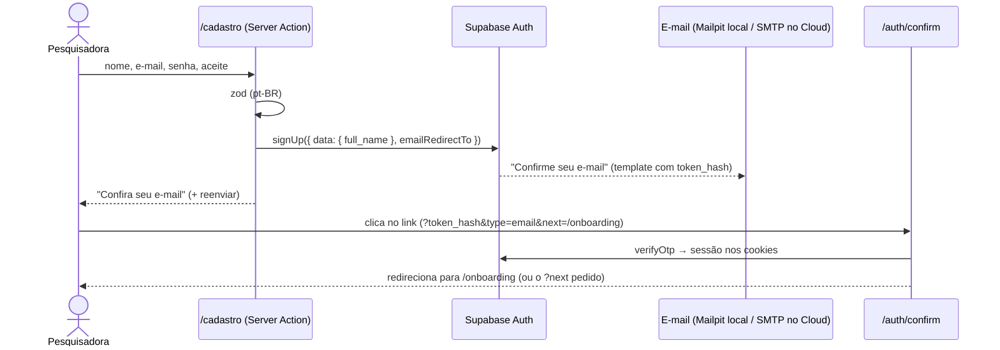

# 11 · Autenticação, onboarding e perfis

> Como uma pesquisadora entra na Artemis, completa o perfil, edita os dados e encontra
> outras membros. Cobre as rotas, as Server Actions, o acesso a dados (RLS), a configuração do
> Supabase e como testar.

**Resumo:** cadastro com e-mail e senha (com confirmação por e-mail), login por senha ou link
mágico, Google opcional, recuperação de senha, onboarding em 4 etapas, edição do perfil em
cartões, foto no Storage, "Baixar meus dados" e exclusão de conta (LGPD) e diretório de
pesquisadoras com filtros. Toda gravação usa a **sessão da usuária** e o **RLS**; a chave secreta
só aparece na exclusão de conta e, na exportação, para ler a inscrição na newsletter do e-mail da
própria conta.

Sumário

1. [Rotas](#1-rotas)
2. [Fluxos de autenticação](#2-fluxos-de-autenticação)
3. [Onboarding](#3-onboarding)
4. [Meu perfil (/perfil)](#4-meu-perfil-perfil)
5. [Diretório e perfil público](#5-diretório-e-perfil-público)
6. [Server Actions e Route Handlers](#6-server-actions-e-route-handlers)
7. [Acesso a dados e segurança](#7-acesso-a-dados-e-segurança)
8. [Configuração (Supabase, e-mails, Google)](#8-configuração-supabase-e-mails-google)
9. [Mapa do código](#9-mapa-do-código)
10. [Como testar](#10-como-testar)
11. [Limitações conhecidas e próximos passos](#11-limitações-conhecidas-e-próximos-passos)

---

## 1. Rotas

| Rota                  | Acesso                                      | O que faz                                                                                                                                                            |
| --------------------- | ------------------------------------------- | -------------------------------------------------------------------------------------------------------------------------------------------------------------------- |
| `/entrar`             | pública (logada → `/forum`, pelo proxy)     | E-mail + senha **ou** link mágico (mesmo formulário, dois botões). Google se habilitado. Respeita `?next=`. Mostra aviso após exclusão de conta (`?conta=excluida`). |
| `/cadastro`           | pública (logada → `/forum`)                 | Nome, e-mail, senha (≥ 8) e aceite do código de conduta + privacidade. Mostra "Confira seu e-mail".                                                                  |
| `/recuperar-senha`    | pública                                     | Envia o link de redefinição (resposta sempre neutra).                                                                                                                |
| `/redefinir-senha`    | exige sessão (link de recuperação ou login) | Nova senha + confirmação. Sem sessão, explica que o link expirou e oferece um novo.                                                                                  |
| `GET /auth/confirm`   | pública                                     | Destino dos links de e-mail (`token_hash` + `type`): `verifyOtp`, grava a sessão e redireciona.                                                                      |
| `GET /auth/callback`  | pública                                     | Retorno do OAuth/PKCE (`code`): `exchangeCodeForSession` e redireciona.                                                                                              |
| `POST /auth/sair`     | sessão                                      | Encerra a sessão neste navegador e volta para `/` (303). GET → 405; POST de outra origem → 403.                                                                      |
| `/auth/erro`          | pública                                     | Explica o problema (`?motivo=link-expirado                                                                                                                           | link-invalido | outro-navegador | oauth | configuracao`). |
| `/onboarding`         | sessão (proxy)                              | Assistente de 4 etapas. Quem já concluiu vai para `?next` ou `/perfil`.                                                                                              |
| `/perfil`             | sessão + onboarding                         | Edição em cartões: foto, sobre você, pesquisa, mentoria, privacidade e IA, conta e segurança.                                                                        |
| `/pesquisadoras`      | sessão + onboarding                         | Diretório com busca e filtros (`q`, `area`, `stage`, `uf`, `mentoras=1`, `pagina`), 24 por página.                                                                   |
| `/pesquisadoras/[id]` | sessão + onboarding                         | Perfil público para membros: apresentação, áreas, mentoria, papers, tópicos, links, denúncia.                                                                        |

"Sessão + onboarding" = `requireOnboardedProfile()` (`src/lib/auth.ts`): sem sessão vai para
`/entrar?next=…`; sem onboarding vai para `/onboarding?next=…`. O proxy (`src/proxy.ts`) faz só a
checagem otimista; **cada página e cada action confere a sessão de novo**.

## 2. Fluxos de autenticação

### Cadastro e confirmação



- O trigger `on_auth_user_created` cria o perfil com `full_name` vindo de `options.data`.
- Se o Supabase devolver sessão na hora (confirmação desligada), a action já redireciona para
  `/onboarding`.
- E-mail já cadastrado: com confirmação ligada o Supabase responde como se fosse um cadastro novo
  (não revela contas). A tela é a mesma.

### Login por senha e link mágico

- `intent=password` → `signInWithPassword` → `redirect(next)`. Erro de credenciais: "E-mail ou
  senha incorretos". E-mail não confirmado: mensagem + botão **Reenviar e-mail de confirmação**.
- `intent=magic` → `signInWithOtp({ shouldCreateUser: false })`. Conta inexistente recebe a
  **mesma** resposta ("Se existir uma conta…") — nada de enumeração de e-mails. Cadastro só pela
  tela `/cadastro`, que exige o aceite do código de conduta.

### Respeitando o `?next=`

Os modelos de e-mail (`supabase/templates/*.html`) usam `{{ .SiteURL }}/auth/confirm?…&next=` com
destino **fixo** (`/forum` no link mágico, `/onboarding` na confirmação). Para levar a pessoa
de volta à página que ela queria, as actions de link mágico e cadastro gravam o destino num cookie
curto (`cd_auth_next`, httpOnly, 1 hora). O `/auth/confirm` consome o cookie nos tipos
`email`, `signup` e `magiclink`; em recuperação, convite e troca de e-mail vale o destino do link.
Aberto em outro navegador, vale o destino do e-mail.

Todo `next` passa por `safeNextPath()` (`src/lib/profile/redirect.ts`): só caminhos internos
(`/…`), nada de `//`, `\`, protocolos, espaços ou rotas de autenticação (evita _open redirect_ e
laços). Testado em `redirect.test.ts`.

### Google (opcional)

O botão "Continuar com Google" só aparece com `NEXT_PUBLIC_AUTH_GOOGLE_ENABLED=true`. A action
chama `signInWithOAuth({ provider: "google", redirectTo: SITE/auth/callback?next=… })` (fluxo
PKCE: o _code verifier_ fica num cookie) e o `/auth/callback` troca o `code` pela sessão.
Configuração na [seção 8](#google).

### Recuperação de senha

`/recuperar-senha` → `resetPasswordForEmail(email, { redirectTo: SITE/auth/confirm?next=/redefinir-senha })`
→ e-mail → `/auth/confirm?type=recovery` cria a sessão → `/redefinir-senha` → `updateUser({ password })`.
A mesma tela serve para **trocar a senha** estando logada (link "Trocar senha" no perfil).
Mensagens tratadas: senha curta, confirmação diferente, `same_password`, `weak_password`, limite de
envio de e-mails (`over_email_send_rate_limit`).

### Sair

`UserMenu` e `MobileNav` (layout) enviam `POST /auth/sair` (formulário). O handler chama
`signOut({ scope: "local" })` — só este navegador — e responde 303 para `/`.

## 3. Onboarding

Assistente com estado no cliente (`OnboardingWizard`) e **uma Server Action por etapa**
(`saveOnboardingStepAction`): cada "Salvar e continuar" grava a etapa, então nada se perde se a
pessoa sair no meio. Ao voltar, o assistente começa na primeira etapa incompleta.

| Etapa               | Campos                                                                                               | Regras (zod, iguais aos CHECKs do banco)                                                                   |
| ------------------- | ---------------------------------------------------------------------------------------------------- | ---------------------------------------------------------------------------------------------------------- |
| 1. Sobre você       | nome completo, pronomes, título curto, fase da carreira, instituição, cidade, estado (UF)            | nome 3–120; fase obrigatória (`CAREER_STAGES`); UF da lista; limites 30/160/160/80                         |
| 2. Sua pesquisa     | áreas (CNPq, agrupadas por grande área), palavras-chave, apresentação, Lattes, ORCID, LinkedIn, site | 1–5 áreas; até 15 palavras-chave (minúsculas, sem repetir, ≤ 60); bio ≤ 2.000; links normalizados (abaixo) |
| 3. Mentoria         | "Quero ser mentorada", "Quero ser mentora", objetivos, oferta + vagas, temas, formatos, idiomas      | mentora: oferta ≥ 20 caracteres e vagas 1–20; participando: ≥ 1 tema (máx. 8), ≥ 1 formato, ≥ 1 idioma     |
| 4. Privacidade e IA | consentimento de IA (opcional)                                                                       | texto exato de `docs/04-mentoria-com-ia.md` §6.4 (18+ e aviso do plano gratuito do Gemini)                 |

Ao concluir: a action confere o mínimo (nome, fase e 1 área — senão volta para a etapa que falta),
grava `onboarded_at`, agenda `refreshMyEmbedding()` com `after()` (não atrasa a resposta; sem
consentimento ou sem chave de IA ele simplesmente não faz nada) e redireciona para `?next`, ou
`/mentoria` (se busca mentoria), ou `/forum`.

**Normalização dos links** (`src/lib/profile/links.ts`): `lattes.cnpq.br/123` vira
`https://lattes.cnpq.br/123`; Lattes precisa ser de `*.cnpq.br` e LinkedIn de `*.linkedin.com`;
só `http(s)`; sem credenciais na URL; ≤ 300 caracteres. ORCID aceita o iD, a URL ou os 16
dígitos colados, **confere o dígito verificador** (ISO 7064 11,2) e é gravado como
`0000-0000-0000-0000`. Depois de salvar, a tela mostra o valor normalizado.

**Campos condicionais:** desligar "Quero ser mentora" não apaga a oferta escrita — o servidor só
grava oferta/vagas quando a chave está ligada (idem objetivos de mentoranda).

**Acessibilidade:** um `h1` por página; o foco vai para o título da etapa ao avançar e para o
primeiro campo inválido após um erro; erros junto do campo (`aria-invalid` + `aria-describedby`)
e resumo no `FormMessage` (região `aria-live`); indicador de etapas com `aria-current="step"`.

## 4. Meu perfil (/perfil)

Os **mesmos componentes de campos** do onboarding (`src/components/profile/*-fields.tsx`), cada
seção num cartão com o próprio botão "Salvar" (`saveProfileSectionAction`). Depois de salvar:
`revalidatePath("/", "layout")` (o cabeçalho também mostra nome e foto) e `refreshMyEmbedding()`
em `after()`.

- **Mentoria:** no perfil aparece também "Disponível para novos pedidos" (`mentor_available`). Um
  campo oculto (`_has_availability`) diferencia "desmarcado" de "não enviado" (o onboarding não
  mostra essa chave).
- **Privacidade e IA:** selo "IA autorizada em <data>" ou "IA não autorizada". Retirar o
  consentimento dispara o trigger do banco que **apaga o embedding e as sugestões salvas**; a
  mensagem confirma isso. Sem autorização, as sugestões de mentoras continuam funcionando com as
  regras da plataforma (o consentimento só liga embeddings e explicações por IA — ver
  [04 · Mentoria com IA](04-mentoria-com-ia.md)).
- **Foto:** o navegador recorta um quadrado central, reduz para até 512 px e regrava em WebP
  (isso também **remove os metadados EXIF**, como a localização). O upload vai direto ao bucket
  `avatars` em `<uid>/avatar-<timestamp>.webp` (RLS: só a própria pasta). A action
  `saveAvatarAction(url)` aceita só URLs públicas **da própria pasta** com o nome esperado,
  grava `profiles.avatar_url` e apaga fotos antigas. Arquivos aceitos: PNG, JPG, WebP; o arquivo
  enviado tem no máximo 2 MB (limite do bucket). "Remover foto" limpa a URL e a pasta.
- **Conta e segurança:** e-mail de acesso, data de entrada, "Trocar senha" (`/redefinir-senha`),
  "Baixar meus dados" (abaixo) e "Excluir minha conta".
- **Baixar meus dados (LGPD, art. 18, V — portabilidade):** ver
  [Baixar meus dados](#baixar-meus-dados-portabilidade).
- **Excluir minha conta (LGPD, art. 18):** com `SUPABASE_SECRET_KEY` configurada, um diálogo
  explica o que será apagado e pede para digitar **EXCLUIR**. A action apaga as fotos e o usuário
  (`auth.admin.deleteUser`); o banco remove em cascata perfil, áreas, mentorias, sugestões,
  tópicos e respostas (inclusive anônimos), papers, votos, comentários, denúncias feitas e
  notificações. A inscrição na newsletter fica desvinculada (`profile_id = null`) — o descadastro
  é pelo link do e-mail. Depois a sessão é limpa e a pessoa vai para `/entrar?conta=excluida`.
  Sem a chave secreta, o cartão explica que a exclusão é feita pela equipe.

### Baixar meus dados (portabilidade)

O bloco "Baixar meus dados" (âncora `/perfil#dados`, no cartão "Conta e segurança") tem um `<a>`
comum para `GET /perfil/exportar` — sem `next/link` (o prefetch geraria o arquivo inteiro à toa) e
sem o atributo `download` (assim, se der erro, o navegador volta ao perfil com o aviso em vez de
baixar uma página de erro). A `/privacidade` (seção "Seus direitos") explica o recurso e aponta
para cá.

**Rota** (`src/app/perfil/exportar/route.ts`): exige sessão (o proxy manda visitantes para
`/entrar?next=/perfil/exportar`; a rota confere de novo com `getUser()` e, sem sessão, responde
303 para `/entrar?next=/perfil`). Não exige onboarding: o direito vale para qualquer conta.
Resposta: `200`, `Content-Type: application/json; charset=utf-8`,
`Content-Disposition: attachment; filename="artemis-meus-dados-AAAA-MM-DD.json"` (data de São
Paulo), `Cache-Control: private, no-store, max-age=0`, `X-Robots-Tag: noindex`. Qualquer consulta
com erro derruba a exportação (melhor avisar do que entregar um arquivo incompleto como se
estivesse completo): 303 para `/perfil?exportacao=erro#dados`, que mostra "Não conseguimos gerar
o arquivo agora".

**Dados** (`src/lib/profile/export-data.ts`, server-only): tudo com o cliente **da sessão** — o
RLS limita cada tabela e os filtros pelo id dela restringem ao que é dela; listas paginadas de
1.000 em 1.000 (o `max_rows` do PostgREST). A única exceção é a newsletter
(`newsletter_subscribers` não tem acesso pela API): lida com `createAdminClient()` **só pelo
e-mail da própria conta**, e só se `SUPABASE_SECRET_KEY` existir — sem a chave, o arquivo diz que
a situação não pôde ser consultada.

**Montagem** (`src/lib/profile/export.ts`, puro e testado): cada registro passa por uma lista de
campos permitidos, então colunas a mais nunca vazam. Seções com nomes em português; dentro delas,
os nomes das colunas do banco (estáveis, documentados no [docs/03](03-banco-de-dados.md)).

| Seção                                                   | Conteúdo                                                                                                                                                     |
| ------------------------------------------------------- | ------------------------------------------------------------------------------------------------------------------------------------------------------------ |
| `sobre`                                                 | `formato: "artemis-meus-dados"`, `versao: 1`, `gerado_em`, descrição e observações (o que não entra e por quê)                                               |
| `conta`                                                 | id, e-mail, criação, confirmação do e-mail, último acesso (do Auth)                                                                                          |
| `perfil`, `areas_de_pesquisa`, `palavras_chave`         | todas as colunas do perfil dela (inclusive `role` e consentimento de IA), exceto `search_text`; áreas com slug e nome                                        |
| `mentoria.pedidos_enviados` / `pedidos_recebidos`       | os dois papéis; mensagem, resposta, status, datas, nota/motivo do match. Da **outra pessoa, só `{ id, full_name }`** (`mentora` / `mentoranda`)              |
| `mentoria.sugestoes_salvas`                             | sugestões de mentoras salvas para ela (nota, posição, motivo, sugestões de conversa, origem); da mentora, só `{ id, full_name }`                             |
| `forum.topicos` / `respostas` / `reacoes`               | o que ela assinou **e** o que publicou como anônima (achado pelas linhas dela em `forum_anonymous_authorship`), com `is_anonymous: true`; reações dela       |
| `vitrine.papers_enviados` / `destaques` / `comentarios` | papers enviados (inclusive ocultos), votos dados (com o título do paper, `null` se ele estiver oculto) e comentários                                         |
| `notificacoes`                                          | todas as notificações dela                                                                                                                                   |
| `denuncias_feitas`                                      | alvo, motivo, relato, status e datas — **sem** `resolution_note` nem `resolved_by` (são da moderação)                                                        |
| `newsletter`                                            | `{ disponivel: true, inscricao: { email, status, area_ids, consent_text, datas } \| null }` — sem tokens nem contadores — ou `{ disponivel: false, motivo }` |

Fica de fora: o embedding do perfil (representação numérica da IA, recalculável), anotações da
moderação, registros técnicos dos provedores e qualquer dado privado de outras pessoas. O arquivo
liga o nome dela às publicações anônimas — a tela e a `/privacidade` pedem para guardá-lo em lugar
seguro.

## 5. Diretório e perfil público

### `/pesquisadoras`

- Formulário **GET** (`next/form`): funciona sem JavaScript e a busca fica na URL (dá para
  compartilhar). Com JS, a navegação é no cliente.
- `q`: busca em nome, instituição e título (`ilike`, curinga entre palavras). O termo é limpo
  (`sanitizeSearchTerm`) de vírgulas, parênteses, aspas, `%`, `_`, `*`… para não quebrar o filtro
  `or=(…)` do PostgREST.
- `area`: slug de `research_areas`; uma **grande área** inclui todas as subáreas (embed
  `profile_research_areas!inner` + `in`).
- `stage` (fase), `uf` (estado), `mentoras=1` (só mentoras). Valores inválidos são ignorados.
- Só perfis com `onboarded_at`; ordem alfabética; 24 por página (`Pagination`, `?pagina=`).
- Cartão: foto, nome, pronomes, título, instituição, cidade/UF, fase, selo de mentora
  ("Mentora · 2 vagas", "Mentora · sem vagas agora", "Mentora · pausada"), até 3 áreas.
- Estados: vazio com filtros ("Ninguém com esses filtros"), vazio total, página além da última
  (`?pagina=99` → "Esta página não tem resultados" + link para a primeira, mantendo os filtros),
  erro de carregamento e `loading.tsx` com a mesma grade.

**Vagas abertas:** a usuária não enxerga as mentorias das outras (RLS). As vagas vêm da RPC
`get_mentor_candidates(p_limit: 100)` (SECURITY DEFINER, já calcula `open_slots`); as próprias
vagas são contadas direto (ela participa das próprias mentorias).

### `/pesquisadoras/[id]`

- `generateMetadata` com o nome (dados memoizados com `React.cache`, sem consulta duplicada).
- Id que não é UUID, perfil inexistente ou sem onboarding → `not-found.tsx` (título "Perfil não
  encontrado", com `noindex`).
- CTA: **Pedir mentoria** → `/mentoria?mentora=<id>` (mentora disponível, com vaga, não é a
  própria). Se já existe pedido em aberto entre as duas (consulta direta a `mentorship_requests`,
  nos dois sentidos — o RLS só mostra pedidos de que ela participa, e funciona mesmo com a mentora
  sem vagas ou pausada): "Acompanhar seu pedido" (`?aba=enviadas`), "Responder ao pedido dela"
  (a mentora vendo a mentoranda, `?aba=recebidas`) ou "Ver nossa mentoria" (aceito, `?aba=ativas`).
  "Editar meu perfil" na própria página.
- Seções: Sobre (bio, áreas como filtros do diretório, palavras-chave), Como posso ajudar
  (mentoras: oferta, temas, formatos, idiomas, capacidade), Papers na Vitrine (não ocultos),
  No fórum (só tópicos **não anônimos** — anônimos têm `author_id` nulo e nunca aparecem), Links
  acadêmicos e "Algo errado neste perfil?" com `ReportButton targetType="profile"`
  (componente da moderação).
- Objetivos de mentoria, consentimento de IA e papel (role) **não** aparecem para outras pessoas.

## 6. Server Actions e Route Handlers

Todas validam com zod, devolvem `{ ok: true, … } | { ok: false, error, fieldErrors? }` **com os
valores enviados** (o React 19 limpa o formulário depois de cada action) e conferem a sessão no
servidor. Erros do Postgres com código `CD***` mostram a mensagem pt-BR do banco; os demais viram
mensagens amigáveis (`src/lib/profile/errors.ts`).

| Função                                                       | Arquivo                              | Faz                                           |
| ------------------------------------------------------------ | ------------------------------------ | --------------------------------------------- |
| `signInAction`                                               | `src/app/entrar/actions.ts`          | senha (`redirect(next)`) ou link mágico       |
| `signUpAction`                                               | `src/app/cadastro/actions.ts`        | cadastro (+ cookie de `next`)                 |
| `resendConfirmationAction`                                   | `src/components/auth/actions.ts`     | reenvia a confirmação (resposta neutra)       |
| `signInWithGoogleAction`                                     | `src/components/auth/actions.ts`     | inicia o OAuth (só com a flag)                |
| `requestPasswordResetAction`                                 | `src/app/recuperar-senha/actions.ts` | envia o link de redefinição                   |
| `updatePasswordAction`                                       | `src/app/redefinir-senha/actions.ts` | troca a senha (exige sessão)                  |
| `saveOnboardingStepAction`                                   | `src/app/onboarding/actions.ts`      | grava a etapa; a última conclui e redireciona |
| `saveProfileSectionAction`                                   | `src/app/perfil/actions.ts`          | grava um cartão do perfil                     |
| `saveAvatarAction` / `removeAvatarAction`                    | `src/app/perfil/actions.ts`          | foto de perfil                                |
| `deleteAccountAction`                                        | `src/app/perfil/actions.ts`          | exclusão definitiva (exige "EXCLUIR")         |
| `GET /perfil/exportar`                                       | `src/app/perfil/exportar/route.ts`   | "Baixar meus dados" (JSON, anexo, sem cache)  |
| `GET /auth/confirm`, `GET /auth/callback`, `POST /auth/sair` | `src/app/auth/*/route.ts`            | ver [seção 1](#1-rotas)                       |

## 7. Acesso a dados e segurança

| Dado                                       | Como é lido/escrito                                                                                         | Proteção                                                     |
| ------------------------------------------ | ----------------------------------------------------------------------------------------------------------- | ------------------------------------------------------------ |
| `profiles` (própria)                       | `update()` com a sessão — **nunca `upsert()`** (o `id` não tem GRANT de UPDATE)                             | RLS "edita o próprio perfil" + GRANT por coluna (sem `role`) |
| `profiles` (outras)                        | `select` com **colunas públicas explícitas**                                                                | RLS: só `authenticated` lê (visitantes não veem perfis)      |
| `profile_research_areas`                   | lê as atuais, apaga as que saíram, insere as novas                                                          | RLS: insert/delete só das próprias                           |
| `research_areas`                           | leitura pública, memoizada por requisição                                                                   | —                                                            |
| Storage `avatars`                          | upload no navegador; limpeza no servidor com a sessão                                                       | políticas da pasta `<uid>/`                                  |
| Vagas de mentoras                          | `rpc("get_mentor_candidates")`                                                                              | SECURITY DEFINER, só agregados                               |
| Pedido em aberto com a pessoa do perfil    | `select status, mentee_id` em `mentorship_requests`                                                         | RLS: só participantes                                        |
| Exclusão de conta                          | `createAdminClient().auth.admin.deleteUser(uid)`                                                            | uid vem da sessão                                            |
| Exportação dos dados ("Baixar meus dados") | cliente da sessão em todas as tabelas; newsletter com `createAdminClient()` filtrando pelo e-mail da sessão | RLS + filtros pelo id dela; lista de campos permitidos       |

Outros cuidados: nenhum id de usuária vem do cliente; `next` sempre validado; respostas neutras
em link mágico, reenvio e recuperação; `POST /auth/sair` recusa outras origens; links externos
do perfil com `rel="noopener noreferrer nofollow"`; o diretório e os perfis têm `noindex`.

## 8. Configuração (Supabase, e-mails, Google)

### Variáveis

| Variável                                                           | Para quê                                                                                      |
| ------------------------------------------------------------------ | --------------------------------------------------------------------------------------------- |
| `NEXT_PUBLIC_SITE_URL`                                             | base dos links de e-mail/OAuth (`emailRedirectTo`, `redirectTo`)                              |
| `NEXT_PUBLIC_SUPABASE_URL`, `NEXT_PUBLIC_SUPABASE_PUBLISHABLE_KEY` | cliente do Supabase                                                                           |
| `SUPABASE_SECRET_KEY`                                              | exclusão de conta pelo próprio app e situação da newsletter no "Baixar meus dados" (opcional) |
| `NEXT_PUBLIC_AUTH_GOOGLE_ENABLED`                                  | `true` mostra o botão do Google                                                               |

### Supabase (local e Cloud)

- **URL Configuration:** _Site URL_ = URL pública do app; _Redirect URLs_ = `https://<app>/**`
  (e `http://localhost:3000/**` para desenvolvimento). Os e-mails usam `{{ .SiteURL }}`.
- **Modelos de e-mail:** os arquivos de `supabase/templates/` já apontam para
  `/auth/confirm?token_hash={{ .TokenHash }}&type=…&next=…`. No Cloud, copie cada um em
  _Authentication → Email Templates_ (ou `npx supabase config push`).
- **Confirmação de e-mail** ligada (padrão). **Senha mínima:** 8.
- **Limite de e-mails:** o SMTP embutido do Supabase envia poucos e-mails por hora. Para uso real,
  configure um SMTP próprio (_Authentication → SMTP_), por exemplo o do Resend.
- **Local:** os e-mails ficam no **Mailpit** (<http://127.0.0.1:54324>). As telas mostram esse
  aviso só em desenvolvimento com o Supabase local. O link do e-mail usa o `site_url` do
  `config.toml` (porta 3000); se o app estiver em outra porta, troque a porta no link.

### Google

1. Google Cloud Console → _APIs e serviços → Credenciais → Criar ID do cliente OAuth_ (tipo
   "Aplicativo da Web"). Em _URIs de redirecionamento autorizados_ coloque
   `https://<ref>.supabase.co/auth/v1/callback` (local: `http://127.0.0.1:54321/auth/v1/callback`).
2. Supabase → _Authentication → Providers → Google_: cole Client ID e Secret e ative. Local: em
   `supabase/config.toml`, `[auth.external.google] enabled = true` e as variáveis
   `SUPABASE_AUTH_EXTERNAL_GOOGLE_CLIENT_ID` / `SUPABASE_AUTH_EXTERNAL_GOOGLE_SECRET`.
3. Confirme que `https://<app>/auth/callback` está nas _Redirect URLs_ do Supabase.
4. Defina `NEXT_PUBLIC_AUTH_GOOGLE_ENABLED=true` e reinicie o app.

O perfil é criado pelo mesmo trigger (nome e foto vêm de `name`/`picture` do Google) e a pessoa
passa pelo onboarding como qualquer outra.

## 9. Mapa do código

```
src/app/entrar · cadastro · recuperar-senha · redefinir-senha   páginas + actions de auth
src/app/auth/confirm · callback · sair · erro                   route handlers e página de erro
src/app/onboarding · perfil · pesquisadoras(/[id])             páginas, actions e loading.tsx
src/components/auth/      AuthShell, LoginForm, SignupForm, PasswordInput, GoogleSignIn…
src/components/profile/   campos das seções, AreaPicker, OnboardingWizard, ProfileSectionForm,
                          AvatarUploader, DeleteAccountDialog, ProfileCard, DirectoryFilters…
src/lib/profile/          (puros, testados) redirect, errors, links, schemas, form-values,
                          directory, areas, avatar, auth-schemas, consent, export
                          (servidor) queries, save, account, auth-next, auth-config, export-data
src/app/perfil/exportar/route.ts   GET "Baixar meus dados"
```

## 10. Como testar

### Testes unitários

```bash
npx vitest run src/lib/profile
```

Cobrem: destinos seguros (`safeNextPath`), tradução de erros do Auth e do Postgres,
normalização de links e ORCID (dígito verificador), validação das 4 seções e dos formulários de
auth, leitura do `FormData`, filtros do diretório e limpeza da busca, agrupamento de áreas,
validação da URL do avatar e a montagem do "Baixar meus dados" (`export.test.ts`: campos
permitidos — nada de tokens, `search_text` ou notas da moderação mesmo se vierem na consulta —,
outra pessoa só com id e nome, anônimos marcados pela autoria anônima, sem repetidos, newsletter
indisponível e nome do arquivo no fuso de São Paulo) e o escopo das consultas
(`export-data.test.ts`, com um cliente falso que grava cada consulta: toda leitura com a sessão
filtra pelo id dela — necessário porque `forum_threads`, `forum_posts`, `forum_reactions`,
`paper_votes`, `paper_comments` e `profile_research_areas` têm leitura aberta a qualquer membra —,
anônimos só pelos ids da autoria dela, newsletter só pelo cliente admin e pelo e-mail dela,
paginação de 1.000 e erro em qualquer consulta derrubando a exportação).

### Manual (Supabase local + seed)

Contas de demonstração em `docs/03-banco-de-dados.md` §15 (senha `ciencia-delas-demo`).

1. **Cadastro:** `/cadastro` → "Confira seu e-mail" → abra o Mailpit → clique no link (troque a
   porta se precisar) → onboarding. Teste erros: e-mail inválido, senha curta, sem aceite.
2. **Onboarding:** avance sem fase da carreira (erro), sem área (erro), com ORCID errado
   (`0000-0002-1825-0098` → "não confere"); volte uma etapa e veja os dados salvos; conclua.
3. **Perfil:** salve cada cartão; ligue "Quero ser mentora" sem oferta (erro); envie uma foto e
   remova; retire o consentimento de IA; troque a senha.
4. **Diretório:** como `larissa@…`, filtre por `?area=ecologia`, `?mentoras=1&uf=RJ`,
   `?q=Marina`; abra `/pesquisadoras/d1000000-0000-4000-8000-000000000001` (Marina) — Larissa vê
   "Ver nossa mentoria"; `yasmin@…` vê "Pedir mentoria".
5. **Link mágico:** `/entrar?next=/pesquisadoras` → "Receber link de acesso" → Mailpit → o link
   leva para `/pesquisadoras`. Reabrir o mesmo link → `/auth/erro`.
6. **Recuperação:** `/recuperar-senha` → Mailpit → `/redefinir-senha`.
7. **Baixar meus dados:** como `larissa@…`, `/perfil#dados` → "Baixar meus dados (JSON)" baixa
   `artemis-meus-dados-<data>.json` e a página continua no perfil. Confira que da Marina só vêm
   `id` e `full_name` e que o único e-mail no arquivo é o dela. Como `gabriela@…`, o tópico anônimo
   dela em "Rede de apoio" aparece com `is_anonymous: true`. Sem login, `/perfil/exportar` leva ao
   `/entrar`. `/perfil?exportacao=erro#dados` mostra o aviso de falha.
8. **Excluir conta:** `/perfil#conta` → digite algo diferente de EXCLUIR (erro) → EXCLUIR →
   `/entrar?conta=excluida`; confira no banco que o usuário e o perfil sumiram.

### E2E com Playwright

Para pular a tela de login: `node scripts/e2e/auth-cookies.mjs <email> ciencia-delas-demo
http://localhost:<porta>` imprime os cookies para `context.addCookies()`. Para testar a
recuperação sem gastar e-mail, gere o link com a API admin
(`POST /auth/v1/admin/generate_link {"type":"recovery","email":…}` com a chave secreta) e abra
`/auth/confirm?token_hash=<hashed_token>&type=recovery&next=/redefinir-senha`.

Os fluxos acima foram exercitados assim (cadastro → Mailpit → confirmação → onboarding → perfil
→ foto → senha → exclusão; diretório e perfis como Larissa e Yasmin; link mágico; Google com a
flag ligada), em 390 px e 1440 px, nos temas claro e escuro.

## 11. Limitações conhecidas e próximos passos

- **Destino do link mágico em outro navegador:** como os modelos de e-mail usam destino fixo, o
  `?next` só é respeitado no mesmo navegador (cookie). Alternativa: usar `{{ .RedirectTo }}` nos
  modelos (exige manter as Redirect URLs em dia).
- **Busca sem acentos:** `ilike` diferencia "Patricia" de "Patrícia". Uma RPC com `unaccent`
  ou `pg_trgm` resolveria.
- **Vagas no diretório:** vêm de `get_mentor_candidates` (até 100 mentoras). Com muitas mentoras,
  vale uma RPC dedicada, ex.: `get_mentor_open_slots(p_ids uuid[])`.
- **Proxy e `?next`:** quem já está logada e abre `/entrar?next=/x` é mandada para `/forum`
  (regra do proxy), não para `/x`.
- **Troca de e-mail** ainda não tem tela (o modelo `email_change` já leva a `/perfil`).
- **Status 404:** como as páginas fazem streaming (`loading.tsx`), o perfil inexistente mostra a
  tela de "não encontrado" com `noindex`, mas a resposta HTTP é 200 (comportamento do Next.js).
