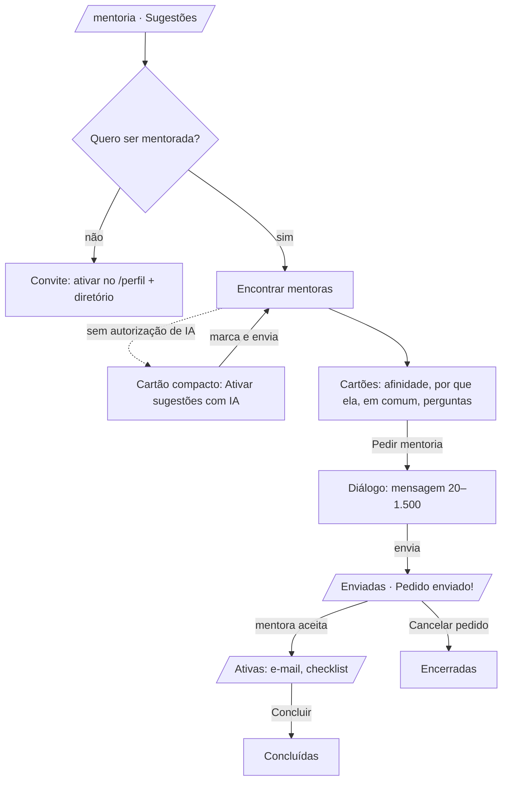

# 12 · Mentoria: telas, fluxos e Server Actions

> Como a página **`/mentoria`** funciona de ponta a ponta: abas, o que cada pessoa vê, as Server
> Actions, como os dados são lidos e como testar. O algoritmo de sugestões (heurística, IA,
> privacidade) está em [04 · Mentoria com IA](04-mentoria-com-ia.md); as regras do banco
> (máquina de estados, capacidade, RLS) em [03 · Banco de dados](03-banco-de-dados.md).

**Resumo:** a mentoranda ativa "Quero ser mentorada", pede sugestões (calculadas pelas regras da
plataforma; a IA é opcional e só entra com a autorização dela), lê por que cada mentora combina
com ela e envia um pedido com uma mensagem. A mentora aceita ou recusa (com resposta
opcional), controla as vagas e pode pausar novos pedidos. Com a mentoria aceita, as duas veem o
e-mail uma da outra, recebem um checklist do primeiro encontro e podem concluir a mentoria.
Tudo roda com a sessão da usuária: o RLS e os triggers do banco garantem as regras.

---

## 1. Rota e abas

| Rota                       | Acesso                                             | O que mostra                                                              |
| -------------------------- | -------------------------------------------------- | ------------------------------------------------------------------------- |
| `/mentoria`                | membros com onboarding (`requireOnboardedProfile`) | aba padrão (ver abaixo)                                                   |
| `/mentoria?aba=sugestoes`  | membros                                            | sugestões de mentoras (+ cartão "Ativar sugestões com IA") ou convite     |
| `/mentoria?aba=enviadas`   | membros                                            | pedidos que ela enviou (em andamento e encerrados)                        |
| `/mentoria?aba=recebidas`  | só quem é mentora (ou ainda tem pedidos recebidos) | disponibilidade, vagas, pedidos aguardando resposta e já respondidos      |
| `/mentoria?aba=ativas`     | membros                                            | mentorias aceitas (as duas participantes), contato, checklist, concluídas |
| `/mentoria?mentora=<uuid>` | membros                                            | link direto: abre o pedido para essa mentora, mesmo sem sugestões         |
| `/mentoria?aviso=<chave>`  | membros                                            | aviso de sucesso depois de uma ação (só chaves conhecidas)                |

- Visitante sem sessão: o proxy manda para `/entrar?next=/mentoria...`; quem não terminou o
  onboarding vai para `/onboarding?next=...`.
- **Aba padrão** (`resolveTab`): link direto → sugestões; mentora com pedidos pendentes →
  recebidas; quem busca mentoria → sugestões; só mentora → recebidas. As notificações de
  mentoria apontam para `/mentoria`, então a mentora cai direto nos pedidos.
- As abas mostram contadores: enviadas pendentes, recebidas pendentes e mentorias ativas.
- No celular a barra de abas rola na horizontal e a aba ativa é centralizada automaticamente.
- Sem Supabase configurado, a página mostra um aviso amigável (sem quebrar).

## 2. Fluxo da mentoranda



1. **Convite** — se `seeks_mentorship = false`, a aba explica e leva para `/perfil` ("Ativar no
   meu perfil") ou para o diretório de mentoras.
2. **Sugestões sem IA (padrão)** — decisão final do produto: as sugestões **não dependem** do
   consentimento de IA. Sem `ai_consent`, o painel "Encontrar mentoras" funciona em modo
   heurístico (texto: "...usando as regras da própria plataforma. Nenhum dado seu vai para
   serviços de IA.") e nada sai do servidor.
3. **Ativar sugestões com IA** — também sem `ai_consent`, entre o botão e a lista aparece um
   cartão compacto (`AiConsentCard`): uma frase explicando que a IA é opcional e um `<details>`
   "Ver o que é enviado e autorizar" com o que a IA recebe e o que nunca sai daqui, o texto oficial
   (`src/lib/profile/consent.ts`, igual ao onboarding/perfil), a orientação para menores de 18 e o
   botão "Ativar sugestões com IA" (`grantAiConsentAction`). O consentimento só liga os
   embeddings (Gemini) e a reordenação/explicação por IA.
4. **Encontrar mentoras** — botão com estado "Analisando perfis…" (a lista anterior fica
   esmaecida; sem lista, aparecem esqueletos). Chama `findMentorsForCurrentUser({ limit: 6 })`.
   Mentoras com quem ela já está em mentoria (pedido aceito) não voltam como sugestão.
   Mensagem de resultado e avisos (ex.: "você acabou de gerar sugestões") aparecem em região
   `aria-live`. Ao carregar a página, as sugestões salvas são lidas sem gastar cota de IA.
5. **Cartão de sugestão** (`MatchCard`) — avatar, nome, título, instituição/UF, selos (Mentora,
   etapa, vagas abertas), `ScoreMeter` com nome acessível, caixa **"Por que ela?"** com o selo
   de origem ("Sugestão por IA (Gemini)" ou "Sugestão por afinidade") e aviso de texto gerado
   por IA, áreas e temas em comum, outros temas, perguntas para puxar conversa, "Pedir mentoria"
   e "Ver perfil".
   - Pedido pendente com ela → selo "Pedido enviado" + "Ver pedido".
   - Mentoria ativa com ela → selo "Mentoria ativa" + "Ver mentoria" (só em sugestões salvas
     antes do aceite: uma nova busca já não traz essa mentora).
   - Sem vagas ou pedidos pausados → botão desligado com o motivo escrito ao lado.
6. **Pedido** (`RequestMentorshipDialog`) — rascunho pronto com o primeiro nome da mentora, a
   primeira pergunta sugerida e trechos entre colchetes para personalizar (o servidor recusa o
   envio se eles continuarem lá); botões "Adicionar" para as outras perguntas; contador de
   caracteres; nota de privacidade (o e-mail só aparece se ela aceitar). Sucesso → redireciona
   para `?aba=enviadas&aviso=enviado`. Nota e motivo da sugestão salva (se houver) vão junto
   (`match_score`, `match_reason`), lidos no servidor.
7. **Link direto** — `/pesquisadoras/[id]` → "Pedir mentoria" → `/mentoria?mentora=<id>`. O
   diálogo abre sozinho. Casos tratados com alerta (sem diálogo): perfil inexistente, o próprio
   perfil, quem não é mentora, mentora sem vagas/pausada, pedido já aberto ou mentoria ativa.
   Um valor que não é UUID é ignorado.
8. **Enviadas** — "Em andamento" (pendentes e ativas) e "Encerradas", com selo de status, tempo
   relativo, a mensagem enviada (recolhível) e a resposta da mentora. Pendente → "Cancelar
   pedido" (confirmação); ativa → "Ver mentoria ativa".
9. **Ativas** — outra participante, papel ("Sua mentora"/"Sua mentoranda"), data de início,
   resposta da mentora, **contato** (`get_mentorship_contact`: e-mail com "Copiar" e `mailto:`),
   pedido original, "Concluir mentoria" (as duas) e "Cancelar mentoria" (só a mentoranda), o
   checklist do primeiro encontro e a lista de mentorias concluídas.

## 3. Fluxo da mentora

1. **Sua disponibilidade** — selo "Recebendo pedidos"/"Pedidos pausados", medidor de vagas
   (`aceitas / mentor_capacity`), texto explicando se ela aparece nas sugestões, botão
   **"Pausar novos pedidos" / "Voltar a receber pedidos"** (`mentor_available`) e link para
   ajustar capacidade e temas no perfil.
2. **Aguardando sua resposta** — para cada pedido: mentoranda (etapa, instituição, áreas,
   temas em que quer ajuda), afinidade estimada, mensagem, campo de resposta opcional (até
   1.000 caracteres) e os botões **Aceitar mentoria** / **Recusar**. Com as vagas cheias aparece
   um alerta, e tentar aceitar mostra a mensagem do banco (`CD001`: "Você já atingiu o limite
   de N mentoria(s) simultânea(s)…"). Aceitar → `?aba=ativas&aviso=aceito`; recusar →
   `?aba=recebidas&aviso=recusado`.
3. **Pedidos já respondidos** — histórico compacto (até 20) com status e data da resposta.

Por que não mostramos `mentoring_goals` da mentoranda para a mentora: as metas de mentoria são
tratadas como dado interno do perfil ([03 §17](03-banco-de-dados.md#17-pegadinhas-e-boas-práticas)).
A mentora vê a mensagem que a mentoranda escreveu para ela, as áreas e os temas públicos.

## 4. Server Actions (`src/app/mentoria/actions.ts`)

Todas: conferem sessão + onboarding no servidor (`getCurrentUser`/`getCurrentProfile`), validam
com zod (`src/lib/mentorship/schemas.ts`), nunca recebem id de usuária do formulário, usam o
cliente com a sessão (RLS) e chamam `revalidatePath("/mentoria")`. Erros voltam no formato
`{ ok: false, error, fieldErrors?, values? }` (os valores digitados voltam para o formulário).

| Action                     | Quem                 | Entrada                                       | O que faz                                                                                                              | Sucesso                                      |
| -------------------------- | -------------------- | --------------------------------------------- | ---------------------------------------------------------------------------------------------------------------------- | -------------------------------------------- |
| `findMentorsAction`        | quem busca mentoria  | —                                             | `findMentorsForCurrentUser({ limit: 6 })` (grava `mentor_suggestions`); sem `ai_consent` = só heurística               | `{ ok, count, source, warnings }`            |
| `grantAiConsentAction`     | membro               | `ai_consent=on`                               | `profiles.update({ ai_consent: true })` (o trigger grava a data) + `refreshMyEmbedding()`                              | → `?aba=sugestoes&aviso=consentimento`       |
| `createRequestAction`      | membro               | `mentor_id`, `message` (20–1.500)             | confere vagas/pedido aberto pela RPC `get_mentor_candidates`; insere `mentorship_requests` com nota/motivo da sugestão | → `?aba=enviadas&aviso=enviado`              |
| `cancelRequestAction`      | mentoranda do pedido | `request_id`                                  | `status → cancelled` (só `pending`/`accepted`, `mentee_id = eu`)                                                       | → `?aba=enviadas&aviso=cancelado`            |
| `respondRequestAction`     | mentora do pedido    | `request_id`, `decision`, `response_message?` | `status → accepted/declined` + resposta (só `pending`, `mentor_id = eu`); capacidade garantida pelo trigger (`CD001`)  | → ativas (`aceito`) / recebidas (`recusado`) |
| `completeMentorshipAction` | participantes        | `request_id`                                  | `status → completed` (só `accepted`)                                                                                   | → `?aba=ativas&aviso=concluido`              |
| `setAvailabilityAction`    | mentora              | `available=true/false`                        | `profiles.update({ mentor_available })`                                                                                | mensagem no próprio formulário               |

Os updates usam `.select("id")`: se nenhuma linha mudou (pedido já respondido, de outra pessoa
ou forjado), a usuária vê "Este pedido já foi respondido ou cancelado… Recarregue a página." e
nada é gravado. Notificações (novo pedido, aceite, recusa, cancelamento, conclusão) são criadas
pelos triggers do banco.

**Avisos (`?aviso=`)** — `enviado`, `cancelado`, `aceito`, `recusado`, `concluido`,
`consentimento` (`parseNotice`). Qualquer outro valor é ignorado: nenhum texto da URL é exibido.

**Erros** (`friendlyMentorshipError`): `CDxxx` → a mensagem pt-BR do banco; `23505` → pedido
duplicado; `23514` → tamanho da mensagem; `42501` → mentora sem receber pedidos / sem
permissão; `PGRST301/303` → sessão expirada; o resto → mensagem genérica por operação.

## 5. Leitura de dados (`src/lib/mentorship/queries.ts`, servidor)

| Função                      | Fonte                                                                                                               | Uso                                         |
| --------------------------- | ------------------------------------------------------------------------------------------------------------------- | ------------------------------------------- |
| `loadMyRequests`            | `mentorship_requests` + `mentee:profiles!mentorship_requests_mentee_id_fkey(...)` / `mentor:...mentor_id_fkey(...)` | todas as abas (contadores e listas)         |
| `loadAreaIdsByProfile`      | `profile_research_areas`                                                                                            | áreas da outra participante e da mentoranda |
| `loadAreaNames`             | `research_areas`                                                                                                    | nomes das áreas                             |
| `getMySavedSuggestions`     | `mentor_suggestions` (de `src/lib/matching/service.ts`)                                                             | sugestões salvas, sem IA                    |
| `loadCandidateAvailability` | RPC `get_mentor_candidates(p_limit: 100)`                                                                           | vagas abertas e pedido aberto por mentora   |
| `loadContacts`              | RPC `get_mentorship_contact(p_request_id)`                                                                          | e-mail na aba Ativas (só mentorias aceitas) |
| `loadDeepLinkMentor`        | `profiles` (colunas públicas explícitas)                                                                            | link direto `?mentora=`                     |
| `loadSuggestionMatch`       | `mentor_suggestions` (nota e motivo da dupla)                                                                       | gravados junto com o pedido                 |

Perfis sempre com colunas explícitas (nunca `select('*')`). A montagem dos cartões é pura
(`buildMatchCards`, `resolveDeepLink` em `view-models.ts`): a mentora fora da lista de
disponíveis aparece sem botão de pedido; se a RPC falhar, o botão fica ligado e o banco decide.

## 6. Arquivos

```
src/app/mentoria/
  page.tsx                    abas, contadores, avisos, link direto
  loading.tsx                 esqueleto da página
  actions.ts                  Server Actions (tabela acima)
  _sections/suggestions-tab.tsx   convite · consentimento · sugestões · link direto
  _sections/request-tabs.tsx      Enviadas · Recebidas · Ativas
src/components/mentorship/
  match-card.tsx              cartão de sugestão
  request-dialog.tsx          diálogo "Pedir mentoria" (cliente)
  find-mentors-panel.tsx      botão "Encontrar mentoras" + carregamento (cliente)
  ai-consent-card.tsx         cartão compacto "Ativar sugestões com IA" (cliente)
  deep-link-card.tsx          pedido por link direto + alertas
  request-cards.tsx           cartões de enviadas, recebidas, ativas e histórico
  respond-form.tsx            aceitar/recusar com resposta (cliente)
  availability-form.tsx       pausar/retomar pedidos (cliente)
  contact-card.tsx            e-mail com copiar/mailto (cliente)
  action-dialog.tsx           confirmação com erro dentro do diálogo (cliente)
  first-meeting-checklist.tsx · person-summary.tsx · status-badge.tsx · scroll-active-tab.tsx
src/lib/mentorship/
  presentation.ts             abas, status, selo IA/afinidade, rascunho, capacidade, avisos (puro)
  view-models.ts              cartões de sugestão e link direto (puro)
  schemas.ts                  zod das actions
  errors.ts                   erros do banco → pt-BR (puro)
  queries.ts                  leituras (server-only)
  types.ts                    estados das actions
```

## 7. Como testar

**Unitários** (helpers puros, 49 testes):

```bash
npx vitest run src/lib/mentorship
```

**Manual / E2E** com o Supabase local e o seed (senha de todas: `ciencia-delas-demo`; e-mails
`@demo.cienciadelas.dev`). Para entrar sem a tela de login em testes Playwright, use
`node scripts/e2e/auth-cookies.mjs <email> ciencia-delas-demo http://localhost:<porta>`.

| Conta       | O que testar                                                                                                                                                                         |
| ----------- | ------------------------------------------------------------------------------------------------------------------------------------------------------------------------------------ |
| `yasmin@`   | "Encontrar mentoras" (a Camila aparece com "Pedido enviado"); enviar um pedido; erro ao enviar o rascunho sem personalizar ou com menos de 20 caracteres                             |
| `renata@`   | mentora com **1 vaga**: aceitar um pedido e tentar aceitar outro → erro `CD001`; recusar com resposta; pausar e retomar                                                              |
| `fernanda@` | pedido pendente da Manuela em "Solicitações recebidas"; aba Sugestões mostra o convite (ela não busca mentoria)                                                                      |
| `larissa@`  | "Mentorias ativas" com a Marina (contato, checklist); "Encontrar mentoras" não traz a Marina; links diretos: `?mentora=<Marina>` (já em mentoria), `?mentora=<Aline>` (indisponível) |
| `marina@`   | mentora com 3 vagas e uma mentoria ativa; histórico de respostas                                                                                                                     |
| visitante   | `/mentoria` → `/entrar?next=%2Fmentoria`                                                                                                                                             |

Para ver o cartão "Ativar sugestões com IA", desmarque a autorização em `/perfil` (seção
Privacidade) ou, localmente, `update profiles set ai_consent = false where id = '<id>'` e depois
volte para `true`. Sem autorização, "Encontrar mentoras" continua funcionando (selo "Sugestão por
afinidade").
Ao testar, prefixe mensagens com `[teste]` e limpe depois:

```sql
delete from mentorship_requests where message like '[teste]%';
delete from mentor_suggestions where mentee_id = '<id da conta de teste>';
```

O que foi verificado na entrega: todas as abas com mentoranda, mentora e visitante; envio,
cancelamento, aceite, recusa, capacidade cheia, pausa/retomada, conclusão, consentimento e links
diretos; formulário forjado (mentora tentando responder pedido de outra → nada muda no banco);
390 px e 1440 px, claro e escuro, sem rolagem horizontal; `axe-core` (WCAG 2.2 AA) sem
violações; sem erros de console nem de hidratação.

## 8. Limitações conhecidas

- **Sessão expirada no meio da página:** o proxy redireciona o POST da Server Action para
  `/entrar`, e o React mostra a tela de erro ("Algo saiu da órbita") em vez da mensagem amigável
  da action. Nada é gravado. Correção sugerida no `src/lib/supabase/proxy.ts`: não redirecionar
  requisições com o cabeçalho `Next-Action` (as actions já verificam a sessão).
- A RPC `get_mentor_candidates` não devolve mentoras sem vagas, então a mentoranda não vê
  "0 vagas": vê "sem vagas ou pausou novos pedidos".
- Sem chaves de IA, sem autorização da usuária (ou com a IA fora do ar) as sugestões usam só a
  heurística e o selo diz "Sugestão por afinidade"; o restante do fluxo é idêntico.
